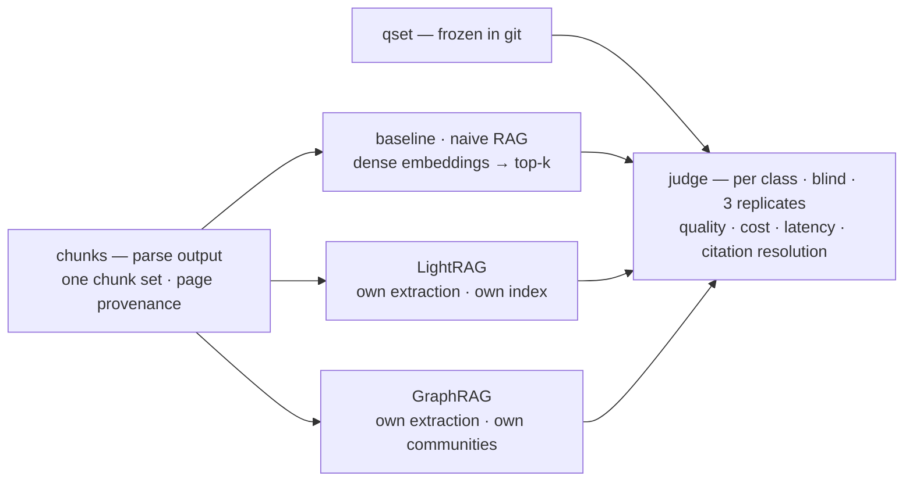
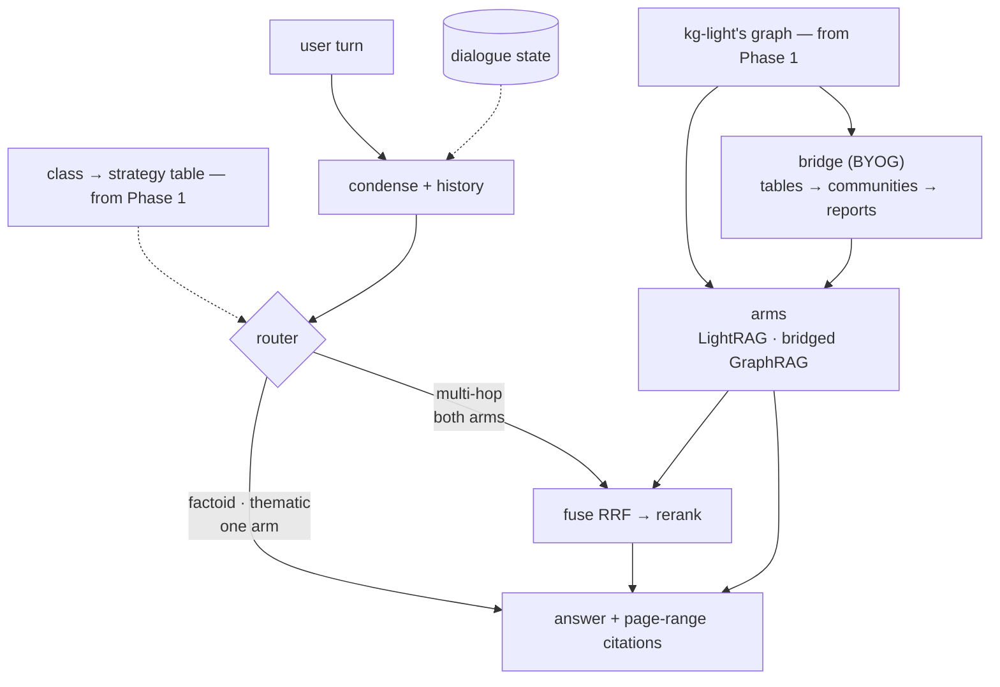

# HyRAG — benchmark two augmentation methods, then unify them

Two deliverables over one corpus of Airbus/Boeing-related documents — two phases, kept apart:

1. **Phase 1 — the benchmark.** Three complete systems answer the same frozen question set over the same chunks — a **naive-RAG baseline**, **LightRAG**, and **GraphRAG** — judged per question class, plus cost, latency and citation resolution. *It never ships.*
2. **Phase 2 — the delivered dialogue system.** One extraction pass: LightRAG extracts, its graph feeds GraphRAG's community layer, a router sends each turn to the arm the benchmark says wins that class, and every answer carries `file, §section, p. N–M` citations. *It never re-measures.*

One sentence: **measure three systems standalone; deliver a fourth that shares one graph, routes per class, and holds the conversation.**

Why unify at all: extraction dominates indexing cost, and the benchmark keeps GraphRAG's native index around — so the price of sharing one graph is a **measured number**, not an assumption (the *Evaluation protocol* section below).

---

## Architecture at a glance

**Two phases, two pictures — kept apart on purpose.** Phase 1 measures and never ships; Phase 2 ships and never re-measures. What they share is the corpus, the chunks and the question set.

### Phase 1 — the benchmark

Three systems, one question set, one judge — each measured as its authors built it. Output: the per-class results table **and** the `class → arm` table Phase 2's router runs on.

### Phase 2 — the delivered dialogue system

One extraction pass, one graph, two arms, one cited answer. The router picks a **strategy** per class — one arm for factoid and thematic, both fused for multi-hop — from a table read off Phase 1's results. No naive arm and no GraphRAG-native index here: both belong to Phase 1.

All four rows of the judge read the **same chunks**, so a difference between them comes from extraction and retrieval rather than from chunk boundaries. The decision record and the protocol are below.

---

## How this repo is laid out

| where | what |
|---|---|
| **`README.md`** (this file) | the architecture, the decisions, the protocol and the current state — the whole design in one place |
| `nodes/⟨id⟩-*.md` | one design page per pipeline stage, written when that stage opens. `corpus`, `parse`, `qset`, `baseline` and `kg-light` are closed; `kg-graph` is next |
| `hyrag/` | the pipeline: `parse/` (PDFs → anchored blocks) · `chunker/` (blocks → chunks carrying page ranges) · `qset/` (the question set's drafting harness) · `embedding/` (one encoder for all four rows) · `serving/` (the OpenAI-compatible `/v1/embeddings` service over that encoder, plus its equality check) · `baseline/` (the R1 index: `store.py`, `answer.py`, `cli.py`, `checks.py`) · `kg_light/` (R2: `chunker.py` returns the shared chunks to LightRAG, `builder.py` wires the row, `ingest.py` runs the pass, `idmap.py` is §5.6's map, `checks.py` is the gate) |
| `qset/questions.jsonl` | the evaluation instrument: 150 questions, each with a gold answer and an evidence target |
| `papers/` | the source papers — `graphrag_google.pdf` **is** the Microsoft GraphRAG paper despite the filename, `rag.pdf` is Lewis et al. 2020. Third-party PDFs, not redistributed here |

**Vocabulary — "node" means four different things here:** a **roadmap node** (a box in the phase diagrams above), a **node page** (its design doc under `nodes/`), a **LangGraph node** (a step in the `StateGraph`), and a **KG node** (an entity in the graph). Say *box*, *page*, *step*, *entity* when it matters.

---

## The three question classes

Every row is measured on the same three kinds of question, and the class is what the router later routes on.

| class | what it asks | what it separates |
|---|---|---|
| **factoid** | one fact, present in one chunk — *"What's the maximum operating altitude of the A320?"* | chunk-level retrieval; dense RAG is strong here |
| **multi-hop** | two facts that must be connected — *"Which systems does the CFM56-7B26 engine affect on the 737NG?"* | graph traversal: the connection lives between chunks, never inside one |
| **thematic** | recurring themes across documents — *"What are the recurring themes in the accident reports across both manufacturers?"* | summarisation over communities; no chunk list answers it |

The instrument is `qset/questions.jsonl` — **150 questions, 50 per class**, each with a gold answer and the evidence target (the chunk ids, hence the page range) that contains it. It was frozen before any router existed; that commit is the proof.

---

## Component contracts

Each box as a black box: what it is responsible for, and what it is explicitly **not**.

| box | contract | not responsible for |
|---|---|---|
| **Parse** | text with section structure, table integrity and a resolvable page range per chunk | embeddings, entities, retrieval |
| **Chunker** | chunks that carry their block ids, deduplicated, with every collapsed duplicate's locations kept | the chunk-size policy beyond the measured setting |
| **Question set** | 150 questions, 50 per class, each with a gold answer and an evidence target | judging, retrieval, routing |
| **Baseline index** | standalone dense retrieval over the shared chunks — the naive RAG both papers use as their control | graphs, communities, lexical retrieval, reranking |
| **LightRAG index** | entities, relations (+keywords), chunks, vectors, and an unbroken provenance chain back to a source page | summarisation, community structure |
| **GraphRAG native index** | GraphRAG's own extraction, communities and reports over the same chunks | the delivered system |
| **Bridge + community layer** | GraphRAG's tables built from LightRAG's graph, then a hierarchy of communities with one report each | retrieval, routing |
| **Condense** | turn N + history → one standalone query | choosing a retrieval strategy |
| **Router** | standalone question → one strategy class, from the benchmark's class→strategy table | retrieval, generation |
| **Retrieval arms** | one interface: `question → ranked evidence + provenance + AnswerRecord` (answer, citations, evidence ids, tokens, latency) | generation, conversation state |
| **Fuse / generate** | one answer whose citations resolve to a real page | routing |
| **Dialogue state** | conversation memory across turns; `thread_id` = conversation | being a second, unversioned knowledge store |
| **Evaluation** | four rows × three classes, reproducible from one command | tuning the system it measures |

---

## Decisions

The spine of the design: each row is a decision an examiner can attack, with the reason it survives.

| # | decision | why |
|---|---|---|
| **D1** | the delivered system shares **one extraction pass**; the benchmark runs both systems natively | extraction dominates indexing cost, and running both natively turns the merge into a *measured* number rather than an assumption |
| **D2** | **LightRAG extracts, GraphRAG summarises** — the community layer only | one graph, two representations; nothing is extracted twice in the delivered system |
| **D3** | community reports live in GraphRAG's own tables, never inside LightRAG | the bridge feeds a documented workflow instead of forking either library |
| **D4** | GraphRAG runs **natively** in the benchmark and as a workflow subset in the delivered system | the benchmark must measure the method, not our conversion of it |
| **D5** | **route before retrieval, fuse by rank if at all** — the class→strategy mapping is a table in our code | a model must not make the routing decision, or it cannot be ablated |
| **D6** | condense the turn (history + question → one standalone query) **before** routing | otherwise the router and the retriever see a pronoun with no referent |
| **D7** | community reports reach the user only through the thematic arm | a report is synthesised text, and that is what the thematic class asks for |
| **D8–D8c** | judged per class over four rows with an opposing **control criterion**; blind and shuffled; pointwise matrix plus one pairwise headline; **citation resolution decided by code, not by a model** | a longer answer wins every comparison without a control criterion; ranks and deterministic checks cannot be gamed |
| **D9** | Postgres + `pgvector` — no second store, no ChromaDB | one place for KV, vectors and status; neither graph system ships a lexical index anyway |
| **D10** | extraction is **incremental**, the community layer is **rebuild-only** | communities are a global property of the graph; pretending otherwise yields stale reports |
| **D11** | the corpus is frozen for the evaluation; batch refresh is designed-for, not built | a moving corpus makes every number unattributable |
| **D12** | thematic retrieval uses **dynamic community selection**, never flat top-k | rating from the root down prunes whole subtrees, so deeper evidence is still reached |
| **D13** | citations are `file, §section, page range` — never a single page | **59% of chunks cross a page boundary**; one page number is a claim the reader will catch out |
| **D14** | the corpus is chosen by **extractability, not brand** | the most official free document — dimension tables, no prose — is the worst material to build a graph from |
| **D15** | Postgres + NetworkX, **no containers** | `pgvector` is bottled, the graph stays an in-process Python object, and the server runs single-worker |
| **D16** | **one chunk set for all four rows** | a difference between rows must come from extraction and retrieval, never from where the text happened to be cut |

**The provenance chain, and the trap in it.** A citation resolves through **ids**, never through text: chunk → the block ids it was built from → each block's physical page → the document's printed-page map, which may legitimately have no entry — then the citation says `(physical)` rather than guessing. The trap: LightRAG keys a chunk by a hash of its **content**, so two byte-identical chunks (routine in an MMEL) would collapse into one key with one `file_path`, and the citation would name the wrong document. Exact duplicates are therefore collapsed **at chunking** with every location recorded, and the citation enumerates them.

---

## Evaluation protocol

The protocol comes from the two source papers; their published numbers do not — different corpus, different model, different questions.

- **Four rows, three classes.** Naive RAG · LightRAG · GraphRAG, each standalone, plus the delivered system once it exists. Every row answers the same frozen question set over the same chunks.
- **Judged blind and shuffled** — pointwise for the matrix, one pairwise comparison for the headline, three replicates, because a judge is stochastic. One criterion opposes the others on purpose.
- **Three hard metrics, not judged:** cost per query, latency per query, and **citation resolution** — does the cited `file, §section, p. N–M` actually contain the cited content?
- **One ablation:** the same global search over GraphRAG's native graph and over the bridged one. The delta is the measured price of sharing a single extraction pass.
- **Reproducible from one command**: the frozen question set, the judge's prompts and rubric version saved beside the results, library versions pinned.

---

## State — as of 2026-10-17

**Phase 1 is complete — corpus frozen, parse and chunker done, question set frozen, all three benchmark rows built, the judged table produced — and Phase 2 is under way: `bridge` and `router` are closed.** 18 documents · 3,939 pp (`CORPUS.md`, `corpus.sha256`); dev slice v1 · 508 pp (`slice.sha256`) — and the benchmark is evaluated on **the slice**, not the full corpus. The pipeline goes `parsed/<stem>/blocks.jsonl` → **375 chunks** (369 unique, 6 collapsed) → **150 questions** (50 factoid · 50 multi-hop · 50 thematic) → **150 generated answers**, every one carrying a citation. Each augmentation row owns an index: LightRAG's **4,525 entities · 6,835 relations** behind a **bijective** key map, GraphRAG's **2,817 entities · 5,895 relations · 644 communities** with a report each, and the bridged index sharing LightRAG's graph — **4,389 entities · 6,775 relationships · 932 communities**, with a report each.

Restructured for the two-part assignment: three standalone systems are benchmarked, and the delivered system is a fourth row that shares one graph. **Phase 1 measures; Phase 2 delivers — and Phase 1's result is that the augmentations win the papers' rubric, with a measured cost in accuracy and latency.** The demo is gone; the deliverable is an oral presentation plus a report.

- **`corpus`, `parse`, `qset`, `baseline` → done.** Each chunk keeps the block ids it was built from, so `§section` and the page range are **derived**, never guessed: a citation is `file.pdf, §section, p. N–M`, verified end to end (111/111 checks). The **`qset`** is frozen at commit **`2c5de79`** — and that commit predates any `router`, which is the ordering the whole benchmark rests on.
- **The baseline row is the benchmark's first number.** 150/150 questions answered, every answer carrying at least one citation, zero fabricated sources; 2.44 M prompt + 291 k completion tokens, 10.4 s mean latency, `k = 20`. Its per-class **retrieval** hit rate is what the other two rows have to beat: factoid **50/50** inside the top 5, multi-hop **49/50** inside the top 10, thematic only **20/50** at `k = 20` — climbing to **48/50** by `k = 100`, which makes it a context-budget problem rather than a retrieval failure (`nodes/baseline.md` → Discoveries).
- **`kg-light` closed 2026-10-16 — gate green** (`sessions/S07-kg-light.md`). LightRAG (`453dce8`) ingested **our** 369 chunks through a fourth ingestion route — SDK raw enqueue plus a custom chunker — because each of the three documented routes trades one of our chunks / our `file_path` / extraction. The trade taken: the chunks are not sidecar-backfill eligible, so page provenance comes from our own map, which is what §5.6 asks for anyway. Measured: **2,347 LLM calls · 3.43 M tokens · 648.8 s** for the extraction pass (**6.4 calls / 9.3 k tokens per chunk**) — the cost side of D1, now a number. The gate, all printed: map **369 ↔ 369 bijective**, **14,927 `source_id` references with 0 unmapped**, four `vector(1024)` columns, and a query per class returning entities, relations and chunks. The endpoint R1 was owed is closed too: all 369 chunks are **identical** through the module and through HTTP — `max|Δ| 0.000e+00` on the full set, both encodings (`hyrag.serving.checks`; a request whose shape differs from the reference's batching can differ by ~2e-07 in float32, which the check prints and tolerates at 1e-06 — a real encoding difference is ≥ 1e-03). **R2's completion calls go through the local proxy** (`hyrag/serving/llm.py`), so this row reports cost per query the way R3 does — verified: 2 calls · 35,303 tokens · 30.9 s on an uncached question.
- **`kg-graph` closed 2026-10-16 — gate green** (`sessions/S08-kg-graph.md`). GraphRAG 3.3.0 ran **natively** over the same chunks in its own interpreter (it cannot share one with `docling` — disjoint `typer` ranges) and through its own CLI: exit 0 in **1,527.2 s**, **369/369 text units matched to our chunks by content**, **2,817 entities · 5,895 relations · 644 communities · 644 reports**, **2,655 LLM calls · 5.94 M tokens · 0 errors**. One structural repair was needed and lives in our own service: GraphRAG asks for `json_schema` structured output, DeepSeek has only `json_object`, so `hyrag/serving/llm.py` rewrites the type (675 of 2,655 calls) and counts every call's tokens. Its thematic global query answered in **25,730 characters / 344 s** with dynamic community selection, and its `[Data: Reports (…)]` citations **resolve** — 115 marker ids → **210 `file, §section, p. N–M` citations, 0 unresolved** (`hyrag/kg_graph/resolve.py`). **With R2's 3.43 M tokens and 10.8 min beside it, D1's ledger is complete: the second extraction pass cost 5.94 M tokens and 25.5 min.**
- **`judge` closed 2026-10-16 — gate green** (`sessions/S09-judge.md`), and **Phase 1 is complete**. Scale decided up front: R3's thematic cell — the only expensive one — was sampled at **n=20** (systematic, every 2.5th question; all 11 documents; ids in `results/judge_pins.json`), everything else at the full 50. Generation: R2 150/150 ($0.97) · R3 120/120 (20 thematic `global`, 50 + 50 `local`, $8.44) · R1 already on disk. Judging: **5,220 pointwise scores · two blind pairwise protocols (720 comparisons) · 15 blinding controls · 0 failures**. **The rubric is the papers' three criteria** (Comprehensiveness · Diversity · Empowerment; changed 2026-10-16), with a gold-anchored **Accuracy** column beside it and never inside it. **The papers' result reproduces: kg-graph wins every class head-to-head — 76% factoid · 65% multi-hop · 90% thematic** (per-question majority 39/50 · 33/50 · 20/20) — at a measured cost: it is the **least accurate** row on the two classes with a gold answer (0.92 / 0.79 against 0.90 / 0.90), its factoid retrieval misses the target chunk 8 times in 50, and its thematic cell costs **$0.38 and 358 s per query** (79×) for a 24,056-character report. **Head-to-head, the two LightRAG claims split**: kg-light beats the naive baseline **56%** (factoid) and **74%** (multi-hop) and ties on thematic — but loses to kg-graph **18% · 24% · 5%**, so "LightRAG beats conventional RAG" reproduces and "LightRAG beats GraphRAG" does not (`results/head_to_head.csv`, two-way, 1,080 comparisons). **The pointwise matrix disagrees with the pairwise and the ceiling explains it**: 94% of Comprehensiveness scores are exactly 1.0, so a bounded scale cannot rank "covers more"; §7.2 makes the paired comparison the number that carries the claim, and the strategy table follows it. **The padding control was run and dropped**: with it the ranking inverts (baseline 82% / 76% / 50%), which is exactly why it is now a *sensitivity* run (`results/judge_pairwise.jsonl`) rather than the table. `results/class_strategy.json` reads **kg-graph for all three classes** with cost and the pointwise best beside it; the blinding control says the comparison was blind (44% against 33% chance). Whole-benchmark spend ≈ **$14** including both index builds; the judged table $1.58 (`sessions/S09-judge.md` → Findings).
- **`bridge` closed 2026-10-17 — gate green** (`sessions/S10-bridge.md`). GraphRAG 3.3.0's **community layer only** — `create_communities · create_community_reports · generate_text_embeddings`, switched by a `workflows:` list in the root's settings copy — over LightRAG's graph re-expressed as four parquet tables. **4,389 entities · 6,775 relationships → 932 communities · 932 reports**, run twice and **identical** (byte-exact except `communities.id`, which GraphRAG assigns `uuid4()`; run two served **930/932 reports from cache** with 2 proxy calls). **0 dangling `text_unit_ids`** in both directions, **342/369 chunks reachable** from reports (native R3: 338). Cost, measured: **1,059 calls · 4.56 M tokens · $1.00 · 30.2 min** against R3's 2,655 / 5.94 M / 25.5 min — sharing the graph pays in **calls (−60%) and tokens (−23%)**, not in wall clock: embeddings dominate, and the bridged graph is 56% larger. **The trap it cost:** GraphRAG's `stable_lcc` uppercases every edge endpoint and `create_communities` joins those names back to `entities.title`, so mixed-case titles are dropped with no log line — 370/4,525 entities reached a community (8%) before the names were normalised, 3,771/4,389 (86%) after.
- **`router` closed 2026-10-17 — gate green** (`sessions/S11-router.md`). Condense then classify (D6, D5): one proxy call each, `thinking` off, `temperature 0`, JSON mode for the label. The held-out split — **120 dev / 30 eval**, by rule, frozen before the prompt was written — scores **0.867**: factoid **1.00**, thematic **1.00**, **multi-hop 0.60**. The dev half shows **0.62**, and that agreement is the finding: those questions read like single-fact lookups and are labelled multi-hop because *answering* them needs two places, so a text-only router has a ceiling there (a multi-hop miss loses fusion, not the arm). **The strategy table states the budget it was chosen under — ≤ 60 s / ≤ $0.02 per turn — and the budget deliberately loses the benchmark's thematic winner**: kg-graph's 90% pairwise win costs 357.8 s and $0.380 per query (≈ 500 s / ≈ $0.55 bridged, at 932 reports), so thematic ships on kg-light (51.3 s / $0.0094) and the report carries the price. Node cost ≈ **$0.02**.
- **Outputs:** `parsed/<stem>/blocks.jsonl` (LightRAG sidecar format) · `parsed/<stem>/meta.json` · `parsed/<stem>/chunks.jsonl` · `parsed/_ingest.jsonl` (the set every row reads) · `parsed/kg_light_idmap.json` (the §5.6 map, 369 entries) · `parsed/kg_light_extraction.json` (the extraction cost) · `parsed/lightrag/hyrag/graph_chunk_entity_relation.graphml` (4,525 nodes / 6,835 edges) · `parsed/kg_graph/index_record.json` (R3's run: pin, settings hash, tables, windowed tokens, wall clock) · `parsed/kg_graph_textunit_map.json` (369 GraphRAG text units → our chunks) · `parsed/kg_graph/output/*.parquet` + `graph.graphml` + `lancedb/` · `parsed/kg_graph_bridged/` (the bridged index: `output/*.parquet` + `lancedb/` + `index_record.json` + `run1/` for the gate's diff) · `parsed/llm_proxy.jsonl` · `results/kg_graph_queries.jsonl` · `qset/questions.jsonl` — **committed**. `parsed/` and `results/` are gitignored — regenerable.
- **Run it** — always `uv run …` from the repo root (the packages are not installed, and bare `python` is Anaconda's):
  `python -m hyrag.serving.cli serve` · `… checks --write-reference` then `… checks` — the embedding service (`:8001`) and the equality check every row depends on
  `python -m hyrag.parse.cli parse --all` · `… check --all` · `… show <stem> --headings|--labels|--page N`
  `python -m hyrag.chunker.cli chunk --all` · `… check --all` · `… cite <stem> --index N [--verify] [--drop-provenance]`
  `python -m hyrag.qset.cli show <draft_id>` · `… freeze` — reading the candidates never re-runs a model
  `python -m hyrag.baseline.cli ingest` · `… search --question-id fact-003` · `… check` · `… answer --question-id fact-003` · `… answer --all` (~26 min)
  `python -m hyrag.kg_light.cli ingest [--limit 1] [--retry-failed]` · `… map` · `… query --class thematic` · `… answer [--eval-set]` · `… check` · `… reset` — R2 (~11 min for the full extraction pass; the LLM cache makes a development re-run cheap, and the **scored** `answer` run disables it so the cost column is real)
  `python -m hyrag.kg_graph.cli [--smoke] inputs [--clean]` · `… index` · `… query --class thematic` · `… answer --eval-set` · `… counts` · `… check` — R3 (~26 min; its interpreter is `.venv-graphrag`, rebuilt from `envs/graphrag/requirements.txt`)
  `python -m hyrag.kg_graph.bridge.cli [--smoke] prepare [--clean]` · `… index` · `… rerun` · `… counts` · `… check --against parsed/kg_graph_bridged/run1` — R4's index over R2's graph (~30 min for run one, ~4 min for `rerun`, which is half the gate)
  `python -m hyrag.router.cli split` · `… table` · `… classify --id fact-014` · `… eval [--split dev]` · `… dialogue` · `… check` — the router (≈ $0.002 per eval, 873 ms/query; `check` is the gate)
  `python -m hyrag.judge.cli smoke` · `… run` · `… table` · `… check` · `… figures` — the judged table (~5,200 pointwise calls ≈ $1.4, one command each; `table` is the gate)
  `python -m hyrag.embedding.checks` — the encoder's invariants and its recall curve
- Git: initialised 2026-10-07; the pipeline through `qset` is committed. The one commit whose *order* matters is the question set's (`2c5de79`) — it must predate `router`, and does. Do not amend or rebase it.

---

## Landmines

Non-obvious constraints. Each has already cost time once, or is verified in the source and would cost time silently.

**Corpus**
- All FCOM / FCTM / AMM / AFM / QRH / MEL / CCOM are proprietary **and** carry export-control exposure. Do not use leaked copies. Public substitutes: `CORPUS.md`.
- Pick documents by **extractability, not brand** (D14). Boeing's ACAP is the most official free document and the worst graph material — dimension tables, no prose.
- NTSB docket OEM exhibits are **not republishable** — NTSB's own policy says so.

**Provenance**
- Citations are `file, §section, page range` — **never a single page number** (D13). Page anchors exist in the parser sidecar but LightRAG drops them at chunking, and **59% of chunks span a page boundary** at the shipped chunk size (measured on the slice). The block→page join is custom code we own.
- LightRAG's `native` parser **refuses PDFs** (docx/md/textpack only); `legacy` emits no sidecar. Page-aware parsing is Docling, native, in-process.
- **Duplicate chunk text collapses.** LightRAG keys chunks with a content hash, so two byte-identical chunks — routine in an MMEL — become **one** key with **one** `file_path`, and a citation then points at the wrong document. Handled at chunking: exact duplicates are collapsed and **every** location is recorded, and the checks assert no identical pair reaches the ingest set (6 collapsed on the slice today). Same failure class as the entity merge below, one layer down.
- The bridge's id join is a **map with a gate**, never a fuzzy match — built by reading LightRAG's chunk records back and asserted bijective at ingest, with any unmapped `source_id` a stop-the-line error (see *Decisions* → the provenance chain).
- **The route R2 uses keeps our chunks and loses the sidecar backfill.** LightRAG's three documented ingest paths each trade one of *our chunks* / *our `file_path`* / *extraction*; the fourth — SDK raw enqueue with a custom `chunking_func` — keeps all three, but custom chunker output is **not eligible for source-span sidecar backfill**, so the chunks carry no LightRAG-side page span. Fine here: page provenance comes from our own map (`chunk_id → occurrences → file, §section, page range`). Do not "fix" this by switching to the document pipeline — that re-chunks (D16).
- **The en dash is a landmine for every string comparison.** Our citations use `p. 62–63` with an **en dash U+2013** (`format_page_range`); the model reliably writes `p. 62-63` with an ASCII hyphen. A plain substring check therefore reads a *correct* citation as missing — it cost one answer its citation on the first baseline run. Fold dash variants on both sides before comparing (`hyrag/baseline/answer.py::_fold`). This applies to the **judge's citation-resolution metric** (§7.3) and to anything resolving LightRAG's `* [n] file_path` references back to our provenance. Same family as the `U+2212` minus sign in AIM's page labels.

**Retrieval**
- LightRAG `mix` = local + global + **naive**; `hybrid` = local + global. `mix` already contains the factoid arm, so **`mix` + reranker is the strongest thing the delivered system has to beat**. LightRAG's own README calls community reports *"inefficient"* — part of this project is an empirical test of that claim.
- **LightRAG ships no lexical index at all** — `naive` is chunk-vector-only, and there is no BM25 or `tsvector` anywhere in the codebase. Our baseline is **dense-only** too (decided 2026-10-11, to reproduce the naive RAG both papers compare against), so no row in either phase reads a lexical index — the hybrid baseline was dropped as a scope cut, and the report says so.
- The reranker goes **after** fusion, never before. RRF merges by rank across incomparable score spaces; the reranker re-scores the fused shortlist with one model. RRF's `k` sets the reranker's recall ceiling.
- The class→mode mapping stays a **table in our code**, never a decision made inside the model — otherwise it cannot be ablated.
- GraphRAG's `global_search` returns a **map-reduced answer**, not a ranked evidence list, and its context arrives **truncated and without scores**. Fusion is therefore only attempted where both systems emit comparable units; the thematic class stays route-only.
- Extraction is **incremental**; the community layer is **rebuild-only**. Community detection needs a fixed `seed` or results are not reproducible.

**Libraries and configuration**
- Pin **`graphrag==3.3.0`** and LightRAG at commit **`453dce8`** (v1.5.8). GraphRAG renamed its workflows at 2.0 (`create_final_entities`/`create_final_relationships`/`create_final_communities` → `extract_graph`/`finalize_graph`/`create_communities`), so older write-ups cite names that no longer exist. **The LightRAG pin currently resolves from a pristine local checkout** (`file:///Users/celery/Repos/lightrag-453dce8`) because GitHub fetches died mid-transfer three times; restore the `git+https://…@453dce8` source and re-lock when the network allows — the rev is the citation either way.
- **GraphRAG gets its own interpreter: `graphrag==3.3.0` requires `typer>=0.27`, `docling<0.27`.** No single environment holds both, so R3 lives in `.venv-graphrag` (pinned by `envs/graphrag/requirements.txt`) and is driven through `graphrag index` / `graphrag query` as a subprocess. Its config is versioned (`hyrag/kg_graph/settings.yaml` + `prompts/`) and copied into the run root, with both hashes in `parsed/kg_graph/index_record.json`.
- **GraphRAG's clustering uppercases entity names.** `graphrag/graphs/stable_lcc.py::_normalize_name` runs `html.unescape(name).upper().strip()` on every edge endpoint, and `create_communities` maps the cluster's node names back through `entities.title`. A title in any other case is dropped **silently** — `graphrag index` exits 0, prints no warning, and the communities table simply covers less of the graph: measured 2026-10-17, **370/4,525 entities (8%)** on the first bridged conversion, **3,771/4,389** after normalising the same way. Native GraphRAG never sees it because its extractor emits uppercase titles. Any table fed to the community layer needs uppercase `title`, `source` and `target`.
- **DeepSeek has no `json_schema`, and GraphRAG asks for it.** Community reports pass a Pydantic model as `response_format`; litellm turns that into `json_schema` and DeepSeek answers *"This response_format type is unavailable now"* — 675 of 2,655 calls, all of them community reports, before the repair, and **1,057 of 1,059** on the bridged run (2026-10-17). litellm will not drop it (`response_format` is listed as supported for the provider), so `hyrag/serving/llm.py` rewrites the type to `json_object` and forwards the rest unchanged. That proxy is also where per-call token accounting comes from (`parsed/llm_proxy.jsonl`) — **it logs the window, so any token figure quoted for a run must be filtered by that run's `started_at`/`finished_at`**, or it inherits the smoke root's calls.
- **LightRAG calls an LLM function as `func(prompt, system_prompt=…)`** — prompt positional first, model never positional. A `functools.partial(openai_complete_if_cache, model=…)` fails on the first extraction with *"got multiple values for argument 'model'"*; wrap it, and let the queue wrapper's `max_tokens` win over yours. Same trap for the embedding function: `openai_embed` is already decorated, so pass `openai_embed.func` through `EmbeddingFunc` rather than double-wrapping.
- **A FAILED document is never auto-resumed.** LightRAG's auto-resume set is PENDING/PROCESSING/PARSING/ANALYZING; a genuinely failed document needs an explicit retry, and until then `ingest` reports *"No documents to process"* while the row sits there. Re-enqueueing known content does not refresh it either — it writes a `dup-<hash>` stub that fails and lingers. `hyrag.kg_light.cli ingest --retry-failed` handles both.
- **LightRAG's optional extras are not in its default install** — `openai` and `asyncpg` must be added by hand (its Postgres backend is asyncpg, not psycopg). And `POSTGRES_PASSWORD` must *exist* in the environment even for a trust-auth cluster: `check_storage_env_vars` tests membership, not value.
- File-based storages write under **`working_dir/<workspace>/`**, so the NetworkX graph is at `parsed/lightrag/hyrag/graph_chunk_entity_relation.graphml` — one level deeper than `working_dir`.
- **Two processes sharing one MPS device make embedding-bound checks crawl.** Encode the reference with the server stopped, then compare over HTTP in a process that imports numpy only (`hyrag.serving.checks --write-reference`).
- **Dynamic community selection is off by default** in GraphRAG (`--dynamic-community-selection` = `False`). Miss the flag and global search degrades to flat top-k over reports — the exact thing the design rejects — with no error.
- Community reports reach the caller with their **full text only when `use_community_summary=False`**.
- Do **not** select LightRAG's Postgres **graph** backend: it is Apache AGE-based, a build-from-source hazard on a Homebrew Postgres. Graph storage is NetworkX; Postgres carries KV, vectors and document status.
- Both systems point at the **same** local embedding service; GraphRAG's `vector_size` must match it, and fails fast if it does not.
- **DeepSeek's thinking is on by default** (`deepseek-flash`, effort `high`). Anything that must emit clean JSON — the question drafter, the judge — passes `"thinking": {"type": "disabled"}`. `reasoning_effort: "low"` still thinks, and `chat_template_kwargs` is ignored (verified against the API, 2026-10-11).
- The judge runs **DeepEval offline**: `DEEPEVAL_TELEMETRY_OPT_OUT=1`, and **never** `deepeval login`. The corpus holds © OEM material under terms that forbid posting it on any network, so nothing leaves the machine except to our own DeepSeek endpoint. The key lives in `.env` (gitignored).

**Evaluation**
- The question set **is** frozen before the router exists — `2c5de79`, 150 questions with gold answers. A calendar constraint, not a preference, and that SHA is the proof.
- Never compare our numbers to the papers' published win rates — different corpus, model, questions. Only the protocol transfers.
- **Judged quality is the papers' three criteria**; a padding control was run and moved to a sensitivity variant, because it inverted the ranking rather than qualifying it (2026-10-16). `Accuracy` is reported beside the rubric, never inside it — long *and* right is a claim the rubric alone cannot make.
- Citation resolution is a **deterministic** check over the parse provenance, never a judged score (D8b).

---

## Environment

`brew` · `uv` · `node` · `python3` present. **No Docker** — and none needed.

- **Installed since 2026-10-12:** Postgres 17 + pgvector 0.8.7 (Homebrew, `hyrag` database, trust auth on localhost), `hyrag`'s Python deps via `uv` (docling, tiktoken, psycopg, pgvector, fastapi, uvicorn, openai, asyncpg, pyarrow, `lightrag-hku` at the pin).
- **Two interpreters, on purpose.** The repo's `.venv` holds everything except GraphRAG; `.venv-graphrag` holds `graphrag==3.3.0`, because it and `docling` require disjoint `typer` ranges. Rebuild the second with `uv venv --python 3.13 .venv-graphrag && uv pip install --python .venv-graphrag/bin/python -r envs/graphrag/requirements.txt`.
- **The serving process is something you must start:** `.venv/bin/python -m hyrag.serving.cli serve` (`:8001`) — **straight from the venv, not `uv run`**: `uv run` holds uv's cache lock for the process's lifetime, which blocks `uv cache prune`/`clean` (it cost a 300 s timeout once). It offers `/v1/embeddings` (local bge-m3) **and** `/v1/chat/completions` (DeepSeek, with `json_schema` → `json_object` and per-call token logging). **R2 and R3 both depend on it** — their LLM calls go through the chat route, which is where cost per query comes from; R1 imports the encoder in-process and needs neither (an embedding-only run, e.g. `hyrag.embedding.checks`, is the one thing that works without the service running).

- **Use `uv`, not conda.** `python3` on PATH is Anaconda's. Anaconda's `pg_config` is also on PATH — harmless for bottled installs, a hazard for source builds.
- Storage: **Postgres via Homebrew + NetworkX for the graph** — no containers (D15). `pgvector` for the dense index; `tsvector` is Postgres core but currently has no consumer.
- NetworkX requires the LightRAG server to run **single-worker** (`WORKERS=1`); multiple workers each hold their own graph and corrupt each other.
- **Disk is the tightest constraint on this machine — recheck before every download.** *2026-10-17: **7.7 GB free**, the data volume at 96% (181/228 GB).* The repo is 3.4 GB (`.venv` 1.5 GB · `.venv-graphrag` 0.78 GB · corpus 0.45 GB · `parsed/` 0.65 GB). **Still to come:** the reranker for `fuse` (a bge-m3-class download, ~2.3 GB — unconfirmed, HuggingFace was unreachable when this was written) and the judge's dependencies. **Reclaimable:** `uv cache prune` (uv's cache is mostly unpacked wheels no environment references), `parsed/kg_graph/cache` (194 MB) and `parsed/kg_graph_bridged/` (316 MB, of which 194 MB is the report cache that makes `rerun` cheap). Do not start a model download without clearing space first; a full disk fails as a confusing torch or Postgres error, not as an honest one.

---

## Next step

**Phase 1 is done — the judged table exists.** `results/results.csv` is the deliverable, `results/class_strategy.json` is Phase 2's router input, `nodes/judge.md` → *Discoveries* is the condensed story and `sessions/S09-judge.md` has the full record. Read those before touching Phase 2.

**`bridge` closed 2026-10-17** — `nodes/bridge.md` → *Discoveries* and `sessions/S10-bridge.md`. Sharing the graph bought **−60% calls and −23% tokens** but **not** wall clock (1,810.8 s against R3's 1,527.2 s): embeddings dominate both runs and the bridged graph is 56% larger. Two numbers Phase 2 inherits: the bridged index is **$1.00** to build and a bridged thematic turn rates **932 reports** through dynamic community selection instead of native's 644 — roughly **1.4× R3's 358 s**, which `arms`/`router` must price before `fuse` is built.

**`router` closed 2026-10-17** — `nodes/router.md` → *Discoveries* and `sessions/S11-router.md`. Two numbers the rest of Phase 2 inherits: **0.867 held-out accuracy** with multi-hop as the known boundary, and a shipped table whose budget **excludes the benchmark's thematic winner** — kg-graph wins 90% pairwise there and costs 357.8 s / $0.380, so thematic routes to kg-light and the report states the price.

**`arms` is next**: one interface over kg-light and the bridged index, emitting `AnswerRecord`s with evidence ids, tokens, latency and citations — it consumes the router's table and the `bridge` index, both on disk. Then `fuse` (RRF then a cross-encoder; the model download is ~2.3 GB, check disk first), `answer`, `report`. Remaining spend ≈ **$5–7**, dominated by the R4 judged pass ($1.5–3) and a 5-question bridged ablation sample (~$2.75).

**What Phase 1 hands forward.** On the papers' rubric the augmentation wins on every class, and the thematic class most of all — but the delivered system cannot ship a 358-second, 24k-character turn, so the router's job is to hold the coverage preference at a latency budget. **Phase 2's arms are LightRAG and the bridged GraphRAG, and there is no separate naive arm** (decided 2026-10-16): the naive method returns as LightRAG's own `naive` mode, which is already tuned. **The `judge` addendum** — R4's row and §7.4's native-vs-bridged ablation — waits on `answer`; the harness takes it without change (`judge run --rows R4`), and the ablation should give the bridged arm an **answer-length target**, or the coverage rubric will simply reward whichever arm writes longer.

**Landmine from the judge session:** do not `uv add` while the serving process is running — the resolve rewrote `transformers`/`huggingface-hub` under the live process and `/v1/embeddings` began returning 500 with `/health` still green. Restart it, then run `hyrag.serving.checks` to prove the encoder is bit-identical before trusting any row's stored vectors.
