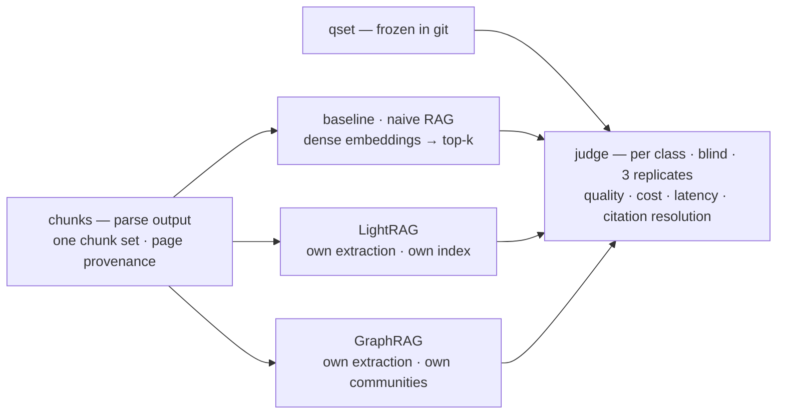
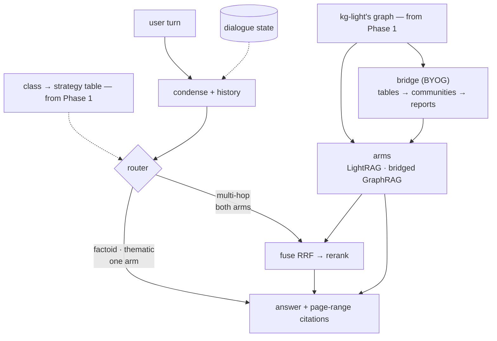

# HyRAG — benchmark two augmentation methods, then unify them

Two deliverables over one corpus of Airbus/Boeing-related documents — two phases, kept apart:

1. **Phase 1 — the benchmark.** Three complete systems answer the same frozen question set over the same chunks — a **naive-RAG baseline**, **LightRAG**, and **GraphRAG** — judged per question class, plus cost, latency and citation resolution. *It never ships.*
2. **Phase 2 — the delivered dialogue system.** One extraction pass: LightRAG extracts, its graph feeds GraphRAG's community layer, a router sends each turn to the arm the benchmark says wins that class, and every answer carries `file, §section, p. N–M` citations. *It never re-measures.*

One sentence: **measure three systems standalone; deliver a fourth that shares one graph, routes per class, and holds the conversation.**

Why unify at all: extraction dominates indexing cost, and the benchmark keeps GraphRAG's native index around — so the price of sharing one graph is a **measured number**, not an assumption (`PREPLAN.md` §7.4).

---

## Architecture at a glance

**Two phases, two pictures — kept apart on purpose.** Phase 1 measures and never ships; Phase 2 ships and never re-measures. What they share is the corpus, the chunks and the question set.

### Phase 1 — the benchmark

Three systems, one question set, one judge — each measured as its authors built it. Output: the per-class results table **and** the `class → arm` table Phase 2's router runs on.

### Phase 2 — the delivered dialogue system

One extraction pass, one graph, two arms, one cited answer. The router picks a **strategy** per class — one arm for factoid and thematic, both fused for multi-hop — from a table read off Phase 1's results. No naive arm and no GraphRAG-native index here: both belong to Phase 1.

All four rows of the judge read the **same chunks**, so a difference between them comes from extraction and retrieval rather than from chunk boundaries. Full structure and the decision record: `PREPLAN.md` §2.1–§2.2 and §4–§7.

---

## Read in this order

1. **`ROADMAP.md`** — the box list. 30-second read. Where we are and what closes each box.
2. **`nodes/⟨id⟩-*.md`** — **the current node's page only.** Written when a node opens, never in advance. *(`nodes/corpus.md` closed 2026-10-07; `nodes/parse.md` is current.)*
3. **`PREPLAN.md`** — architecture and decisions. **Cite by section; do not read it linearly.** §2.1 Phase 1, §2.2 Phase 2, §4 the decisions (D1–D16), §5.6 the id join, §7 the evaluation protocol.
4. **`papers/`** — the source papers. `graphrag_google.pdf` **is** the Microsoft GraphRAG paper despite the filename.

**Vocabulary — "node" means four different things here:** a **roadmap node** (a box in `ROADMAP.md`), a **node page** (its design doc under `nodes/`), a **LangGraph node** (a step in the `StateGraph`), and a **KG node** (an entity in the graph). Say *box*, *page*, *step*, *entity* when it matters.

---

## State — as of 2026-10-08

**Corpus frozen; parse built; chunking is the gap.** 18 documents · 3,939 pp (`CORPUS.md`, `corpus.sha256`); dev slice v1 · 508 pp (`slice.sha256`). `hyrag/parse/` turns PDFs into anchored blocks with section context (12/12 slice documents, 3,181 blocks, 473 headings, checks 12/12).

Restructured this week for the two-part assignment: three standalone systems are benchmarked, and the delivered system is a fourth row that shares one graph. The demo is gone; the deliverable is an oral presentation plus a report.

- **`corpus` → done. `parse` is the current node** (`nodes/parse.md`) — the chunker must keep the block ids it was built from, which is what makes `§section` and the page range derivable rather than guessed. Everything downstream is `unknown`.
- **Parse output:** `parsed/<stem>/blocks.jsonl` (LightRAG sidecar format: `blockid`, `content`, `heading`/`parent_headings`/`level`, `positions[].anchor`+`physical`+`range`) and `parsed/<stem>/meta.json` (page sizes, physical→printed page map with provenance, heading outline, hashes). `parsed/` is gitignored — regenerable.
- **Run it:** `uv run python -m hyrag.parse.cli parse --all` · `… check --all` (invariants + byte-determinism) · `… show <stem> --headings|--labels|--page N`.
- Git initialized 2026-10-07; **first commit pending** — the eval-set freeze is enforced by commit order.

---

## Landmines

Non-obvious constraints. Each has already cost time once, or is verified in the source and would cost time silently.

**Corpus**
- All FCOM / FCTM / AMM / AFM / QRH / MEL / CCOM are proprietary **and** carry export-control exposure. Do not use leaked copies. Public substitutes: `PREPLAN.md` §11.
- Pick documents by **extractability, not brand** (D14). Boeing's ACAP is the most official free document and the worst graph material — dimension tables, no prose.
- NTSB docket OEM exhibits are **not republishable** — NTSB's own policy says so.

**Provenance**
- Citations are `file, §section, page range` — **never a single page number** (D13). Page anchors exist in the parser sidecar but LightRAG drops them at chunking, and **~two thirds of chunks span a page boundary**. The block→page join is custom code we own.
- LightRAG's `native` parser **refuses PDFs** (docx/md/textpack only); `legacy` emits no sidecar. Page-aware parsing is Docling, native, in-process.
- **Duplicate chunk text collapses.** LightRAG keys chunks with a content hash, so two byte-identical chunks — routine in an MMEL — become **one** key with **one** `file_path`, and a citation then points at the wrong document. Detect it, or make chunks unique with a provenance header, before the corpus is ingested. Same failure class as the entity merge below, one layer down.
- The bridge's id join is a **map with a gate**, never a fuzzy match — built by reading LightRAG's chunk records back and asserted bijective at ingest, with any unmapped `source_id` a stop-the-line error (`PREPLAN.md` §5.6).

**Retrieval**
- LightRAG `mix` = local + global + **naive**; `hybrid` = local + global. `mix` already contains the factoid arm, so **`mix` + reranker is the strongest thing the delivered system has to beat**. LightRAG's own README calls community reports *"inefficient"* — part of this project is an empirical test of that claim.
- **LightRAG ships no lexical index at all** — `naive` is chunk-vector-only, and there is no BM25 or `tsvector` anywhere in the codebase. Our baseline is **dense-only** too (decided 2026-10-11, to reproduce the naive RAG both papers compare against), so no row in either phase reads a lexical index — the hybrid baseline was dropped as a scope cut, and the report says so.
- The reranker goes **after** fusion, never before. RRF merges by rank across incomparable score spaces; the reranker re-scores the fused shortlist with one model. RRF's `k` sets the reranker's recall ceiling.
- The class→mode mapping stays a **table in our code**, never a decision made inside the model — otherwise it cannot be ablated.
- GraphRAG's `global_search` returns a **map-reduced answer**, not a ranked evidence list, and its context arrives **truncated and without scores**. Fusion is therefore only attempted where both systems emit comparable units; the thematic class stays route-only.
- Extraction is **incremental**; the community layer is **rebuild-only**. Community detection needs a fixed `seed` or results are not reproducible.

**Libraries and configuration**
- Pin **`graphrag==3.3.0`** and LightRAG at commit **`453dce8`**. GraphRAG renamed its workflows at 2.0 (`create_final_entities`/`create_final_relationships`/`create_final_communities` → `extract_graph`/`finalize_graph`/`create_communities`), so older write-ups cite names that no longer exist.
- **Dynamic community selection is off by default** in GraphRAG (`--dynamic-community-selection` = `False`). Miss the flag and global search degrades to flat top-k over reports — the exact thing the design rejects — with no error.
- Community reports reach the caller with their **full text only when `use_community_summary=False`**.
- Do **not** select LightRAG's Postgres **graph** backend: it is Apache AGE-based, a build-from-source hazard on a Homebrew Postgres. Graph storage is NetworkX; Postgres carries KV, vectors and document status.
- Both systems point at the **same** local embedding service; GraphRAG's `vector_size` must match it, and fails fast if it does not.

**Evaluation**
- The question set must be **frozen before the router exists**. A calendar constraint, not a preference; its commit SHA is the proof.
- Never compare our numbers to the papers' published win rates — different corpus, model, questions. Only the protocol transfers.
- The `Directness` control is non-negotiable; without it a longer answer always wins.
- Citation resolution is a **deterministic** check over the parse provenance, never a judged score (D8b).

---

## Environment

`brew` · `uv` · `node` · `python3` present. **No Docker, no Postgres, no pgvector yet.**

- **Use `uv`, not conda.** `python3` on PATH is Anaconda's. Anaconda's `pg_config` is also on PATH — harmless for bottled installs, a hazard for source builds.
- Storage: **Postgres via Homebrew + NetworkX for the graph** — no containers (D15). `pgvector` for the dense index; `tsvector` is Postgres core but currently has no consumer.
- NetworkX requires the LightRAG server to run **single-worker** (`WORKERS=1`); multiple workers each hold their own graph and corrupt each other.
- **Disk is tight: ≈17 GB free as of 2026-10-07** (the corpus is 0.45 GB). Models, indexes and now **two** graph indexes will dominate.

---

## Next step

Open the **`parse`** node (`nodes/parse.md`): pick the chunk size on the slice, build the chunker so each chunk keeps its block ids, and pass the gate — one real PDF → one retrieved chunk → resolves to `file, §section, p. N–M`, plus the deliberate provenance-drop failure. The chunker also fixes the id space the whole bridge depends on (`PREPLAN.md` §5.6), so the duplicate-text question is answered here, not later.

Then `kg-light` and `kg-graph` can start — and `kg-graph` is Phase 1's critical path, so its full-corpus run should begin as soon as `parse` closes, and Phase 1's results are Phase 2's configuration. Never develop against the full corpus: re-extraction is the one cost that can stop this project.
