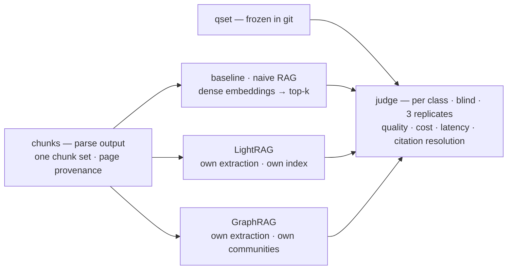
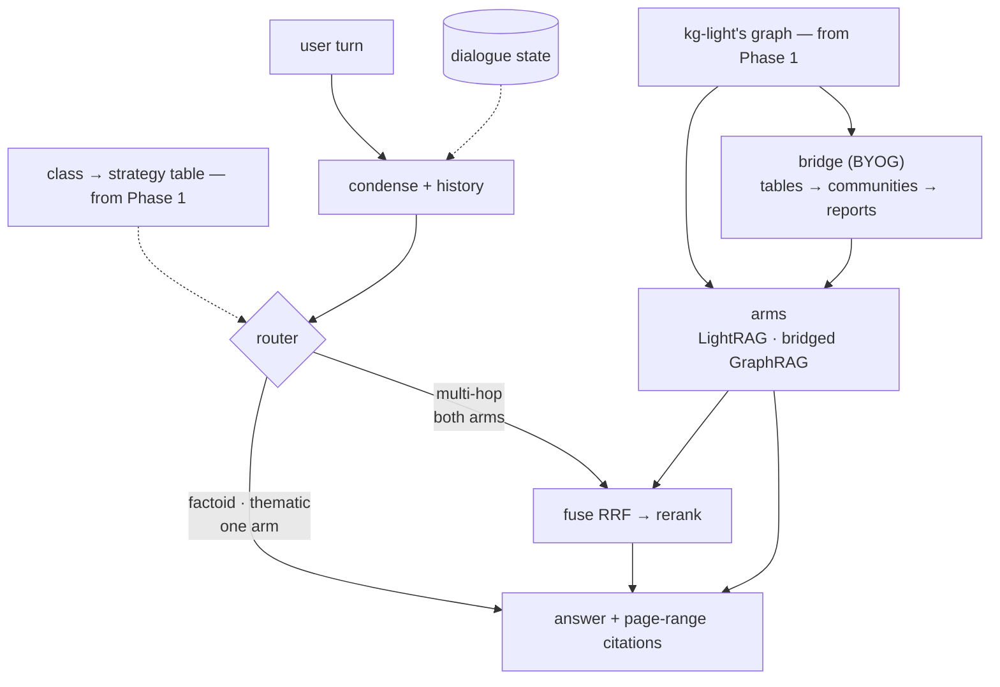

# HyRAG — benchmark two augmentation methods, then unify them

Two deliverables over one corpus of Airbus/Boeing-related documents — two phases, kept apart:

1. **Phase 1 — the benchmark.** Three complete systems answer the same frozen question set over the same chunks — a **naive-RAG baseline**, **LightRAG**, and **GraphRAG** — judged per question class, plus cost, latency and citation resolution. *It never ships.*
2. **Phase 2 — the delivered dialogue system.** One extraction pass: LightRAG extracts, its graph feeds GraphRAG's community layer, a router sends each turn to the arm the benchmark says wins that class, and every answer carries `file, §section, p. N–M` citations. *It never re-measures.*

One sentence: **measure three systems standalone; deliver a fourth that shares one graph, routes per class, and holds the conversation.**

Why unify at all: extraction dominates indexing cost, and the benchmark keeps GraphRAG's native index around — so the price of sharing one graph is a **measured number**, not an assumption (the *Evaluation protocol* section below).

---

## Architecture at a glance

**Two phases, two pictures — kept apart on purpose.** Phase 1 measures and never ships; Phase 2 ships and never re-measures. What they share is the corpus, the chunks and the question set.

### Phase 1 — the benchmark

Three systems, one question set, one judge — each measured as its authors built it. Output: the per-class results table **and** the `class → arm` table Phase 2's router runs on.

### Phase 2 — the delivered dialogue system

One extraction pass, one graph, two arms, one cited answer. The router picks a **strategy** per class — one arm for factoid and thematic, both fused for multi-hop — from a table read off Phase 1's results. No naive arm and no GraphRAG-native index here: both belong to Phase 1.

All four rows of the judge read the **same chunks**, so a difference between them comes from extraction and retrieval rather than from chunk boundaries. The decision record and the protocol are below.

---

## How this repo is laid out

| where | what |
|---|---|
| **`README.md`** (this file) | the architecture, the decisions, the protocol and the current state — the whole design in one place |
| `nodes/⟨id⟩-*.md` | one design page per pipeline stage, written when that stage opens. `corpus`, `parse` and `qset` are closed; `baseline` is current |
| `hyrag/` | the pipeline: `parse/` (PDFs → anchored blocks) · `chunker/` (blocks → chunks carrying page ranges) · `qset/` (the question set's drafting harness) |
| `qset/questions.jsonl` | the evaluation instrument: 150 questions, each with a gold answer and an evidence target |
| `papers/` | the source papers — `graphrag_google.pdf` **is** the Microsoft GraphRAG paper despite the filename, `rag.pdf` is Lewis et al. 2020. Third-party PDFs, not redistributed here |

**Vocabulary — "node" means four different things here:** a **roadmap node** (a box in the phase diagrams above), a **node page** (its design doc under `nodes/`), a **LangGraph node** (a step in the `StateGraph`), and a **KG node** (an entity in the graph). Say *box*, *page*, *step*, *entity* when it matters.

---

## The three question classes

Every row is measured on the same three kinds of question, and the class is what the router later routes on.

| class | what it asks | what it separates |
|---|---|---|
| **factoid** | one fact, present in one chunk — *"What's the maximum operating altitude of the A320?"* | chunk-level retrieval; dense RAG is strong here |
| **multi-hop** | two facts that must be connected — *"Which systems does the CFM56-7B26 engine affect on the 737NG?"* | graph traversal: the connection lives between chunks, never inside one |
| **thematic** | recurring themes across documents — *"What are the recurring themes in the accident reports across both manufacturers?"* | summarisation over communities; no chunk list answers it |

The instrument is `qset/questions.jsonl` — **150 questions, 50 per class**, each with a gold answer and the evidence target (the chunk ids, hence the page range) that contains it. It was frozen before any router existed; that commit is the proof.

---

## Component contracts

Each box as a black box: what it is responsible for, and what it is explicitly **not**.

| box | contract | not responsible for |
|---|---|---|
| **Parse** | text with section structure, table integrity and a resolvable page range per chunk | embeddings, entities, retrieval |
| **Chunker** | chunks that carry their block ids, deduplicated, with every collapsed duplicate's locations kept | the chunk-size policy beyond the measured setting |
| **Question set** | 150 questions, 50 per class, each with a gold answer and an evidence target | judging, retrieval, routing |
| **Baseline index** | standalone dense retrieval over the shared chunks — the naive RAG both papers use as their control | graphs, communities, lexical retrieval, reranking |
| **LightRAG index** | entities, relations (+keywords), chunks, vectors, and an unbroken provenance chain back to a source page | summarisation, community structure |
| **GraphRAG native index** | GraphRAG's own extraction, communities and reports over the same chunks | the delivered system |
| **Bridge + community layer** | GraphRAG's tables built from LightRAG's graph, then a hierarchy of communities with one report each | retrieval, routing |
| **Condense** | turn N + history → one standalone query | choosing a retrieval strategy |
| **Router** | standalone question → one strategy class, from the benchmark's class→strategy table | retrieval, generation |
| **Retrieval arms** | one interface: `question → ranked evidence + provenance + AnswerRecord` (answer, citations, evidence ids, tokens, latency) | generation, conversation state |
| **Fuse / generate** | one answer whose citations resolve to a real page | routing |
| **Dialogue state** | conversation memory across turns; `thread_id` = conversation | being a second, unversioned knowledge store |
| **Evaluation** | four rows × three classes, reproducible from one command | tuning the system it measures |

---

## Decisions

The spine of the design: each row is a decision an examiner can attack, with the reason it survives.

| # | decision | why |
|---|---|---|
| **D1** | the delivered system shares **one extraction pass**; the benchmark runs both systems natively | extraction dominates indexing cost, and running both natively turns the merge into a *measured* number rather than an assumption |
| **D2** | **LightRAG extracts, GraphRAG summarises** — the community layer only | one graph, two representations; nothing is extracted twice in the delivered system |
| **D3** | community reports live in GraphRAG's own tables, never inside LightRAG | the bridge feeds a documented workflow instead of forking either library |
| **D4** | GraphRAG runs **natively** in the benchmark and as a workflow subset in the delivered system | the benchmark must measure the method, not our conversion of it |
| **D5** | **route before retrieval, fuse by rank if at all** — the class→strategy mapping is a table in our code | a model must not make the routing decision, or it cannot be ablated |
| **D6** | condense the turn (history + question → one standalone query) **before** routing | otherwise the router and the retriever see a pronoun with no referent |
| **D7** | community reports reach the user only through the thematic arm | a report is synthesised text, and that is what the thematic class asks for |
| **D8–D8c** | judged per class over four rows with an opposing **control criterion**; blind and shuffled; pointwise matrix plus one pairwise headline; **citation resolution decided by code, not by a model** | a longer answer wins every comparison without a control criterion; ranks and deterministic checks cannot be gamed |
| **D9** | Postgres + `pgvector` — no second store, no ChromaDB | one place for KV, vectors and status; neither graph system ships a lexical index anyway |
| **D10** | extraction is **incremental**, the community layer is **rebuild-only** | communities are a global property of the graph; pretending otherwise yields stale reports |
| **D11** | the corpus is frozen for the evaluation; batch refresh is designed-for, not built | a moving corpus makes every number unattributable |
| **D12** | thematic retrieval uses **dynamic community selection**, never flat top-k | rating from the root down prunes whole subtrees, so deeper evidence is still reached |
| **D13** | citations are `file, §section, page range` — never a single page | **59% of chunks cross a page boundary**; one page number is a claim the reader will catch out |
| **D14** | the corpus is chosen by **extractability, not brand** | the most official free document — dimension tables, no prose — is the worst material to build a graph from |
| **D15** | Postgres + NetworkX, **no containers** | `pgvector` is bottled, the graph stays an in-process Python object, and the server runs single-worker |
| **D16** | **one chunk set for all four rows** | a difference between rows must come from extraction and retrieval, never from where the text happened to be cut |

**The provenance chain, and the trap in it.** A citation resolves through **ids**, never through text: chunk → the block ids it was built from → each block's physical page → the document's printed-page map, which may legitimately have no entry — then the citation says `(physical)` rather than guessing. The trap: LightRAG keys a chunk by a hash of its **content**, so two byte-identical chunks (routine in an MMEL) would collapse into one key with one `file_path`, and the citation would name the wrong document. Exact duplicates are therefore collapsed **at chunking** with every location recorded, and the citation enumerates them.

---

## Evaluation protocol

The protocol comes from the two source papers; their published numbers do not — different corpus, different model, different questions.

- **Four rows, three classes.** Naive RAG · LightRAG · GraphRAG, each standalone, plus the delivered system once it exists. Every row answers the same frozen question set over the same chunks.
- **Judged blind and shuffled** — pointwise for the matrix, one pairwise comparison for the headline, three replicates, because a judge is stochastic. One criterion opposes the others on purpose.
- **Three hard metrics, not judged:** cost per query, latency per query, and **citation resolution** — does the cited `file, §section, p. N–M` actually contain the cited content?
- **One ablation:** the same global search over GraphRAG's native graph and over the bridged one. The delta is the measured price of sharing a single extraction pass.
- **Reproducible from one command**: the frozen question set, the judge's prompts and rubric version saved beside the results, library versions pinned.

---

## State — as of 2026-10-11

**Corpus frozen; parse, chunker and question set done; the benchmark is next.** 18 documents · 3,939 pp (`CORPUS.md`, `corpus.sha256`); dev slice v1 · 508 pp (`slice.sha256`) — and the benchmark is evaluated on **the slice**, not the full corpus. The pipeline goes `parsed/<stem>/blocks.jsonl` → **375 chunks** (369 unique, 6 collapsed) → **150 questions** (50 factoid · 50 multi-hop · 50 thematic), every one with a gold answer and an evidence target.

Restructured this week for the two-part assignment: three standalone systems are benchmarked, and the delivered system is a fourth row that shares one graph. The demo is gone; the deliverable is an oral presentation plus a report.

- **`corpus`, `parse`, `qset` → done.** Each chunk keeps the block ids it was built from, so `§section` and the page range are **derived**, never guessed: a citation is `file.pdf, §section, p. N–M`, verified end to end (111/111 checks, including a spot check of cited pages against the PDFs themselves and a deliberate provenance-drop failure that exits non-zero). The **`qset`** is frozen at commit **`2c5de79`** — and that commit predates any `router`, which is the ordering the whole benchmark rests on. **The next node is `baseline`**; everything downstream of it is `unknown`.
- **Outputs:** `parsed/<stem>/blocks.jsonl` (LightRAG sidecar format: `blockid`, `content`, `heading`/`parent_headings`/`level`, `positions[].anchor`+`physical`+`range`) · `parsed/<stem>/meta.json` (page sizes, physical→printed page map with provenance, heading outline, hashes) · `parsed/<stem>/chunks.jsonl` (chunks carrying their block ids) · `parsed/_ingest.jsonl` (the deduplicated set every benchmark row reads) · `qset/questions.jsonl` — **committed**: 150 questions, gold answers, evidence targets. `parsed/` is gitignored — regenerable.
- **Run it** — always `uv run …` from the repo root (the packages are not installed, and bare `python` is Anaconda's):
  `python -m hyrag.parse.cli parse --all` · `… check --all` · `… show <stem> --headings|--labels|--page N`
  `python -m hyrag.chunker.cli chunk --all` · `… check --all` · `… cite <stem> --index N [--verify] [--drop-provenance]`
  `python -m hyrag.qset.cli show <draft_id>` · `… freeze` — reading the candidates never re-runs a model
- Git: initialised 2026-10-07; the pipeline through `qset` is committed. The one commit whose *order* matters is the question set's (`2c5de79`) — it must predate `router`, and does. Do not amend or rebase it.

---

## Landmines

Non-obvious constraints. Each has already cost time once, or is verified in the source and would cost time silently.

**Corpus**
- All FCOM / FCTM / AMM / AFM / QRH / MEL / CCOM are proprietary **and** carry export-control exposure. Do not use leaked copies. Public substitutes: `CORPUS.md`.
- Pick documents by **extractability, not brand** (D14). Boeing's ACAP is the most official free document and the worst graph material — dimension tables, no prose.
- NTSB docket OEM exhibits are **not republishable** — NTSB's own policy says so.

**Provenance**
- Citations are `file, §section, page range` — **never a single page number** (D13). Page anchors exist in the parser sidecar but LightRAG drops them at chunking, and **59% of chunks span a page boundary** at the shipped chunk size (measured on the slice). The block→page join is custom code we own.
- LightRAG's `native` parser **refuses PDFs** (docx/md/textpack only); `legacy` emits no sidecar. Page-aware parsing is Docling, native, in-process.
- **Duplicate chunk text collapses.** LightRAG keys chunks with a content hash, so two byte-identical chunks — routine in an MMEL — become **one** key with **one** `file_path`, and a citation then points at the wrong document. Handled at chunking: exact duplicates are collapsed and **every** location is recorded, and the checks assert no identical pair reaches the ingest set (6 collapsed on the slice today). Same failure class as the entity merge below, one layer down.
- The bridge's id join is a **map with a gate**, never a fuzzy match — built by reading LightRAG's chunk records back and asserted bijective at ingest, with any unmapped `source_id` a stop-the-line error (see *Decisions* → the provenance chain).

**Retrieval**
- LightRAG `mix` = local + global + **naive**; `hybrid` = local + global. `mix` already contains the factoid arm, so **`mix` + reranker is the strongest thing the delivered system has to beat**. LightRAG's own README calls community reports *"inefficient"* — part of this project is an empirical test of that claim.
- **LightRAG ships no lexical index at all** — `naive` is chunk-vector-only, and there is no BM25 or `tsvector` anywhere in the codebase. Our baseline is **dense-only** too (decided 2026-10-11, to reproduce the naive RAG both papers compare against), so no row in either phase reads a lexical index — the hybrid baseline was dropped as a scope cut, and the report says so.
- The reranker goes **after** fusion, never before. RRF merges by rank across incomparable score spaces; the reranker re-scores the fused shortlist with one model. RRF's `k` sets the reranker's recall ceiling.
- The class→mode mapping stays a **table in our code**, never a decision made inside the model — otherwise it cannot be ablated.
- GraphRAG's `global_search` returns a **map-reduced answer**, not a ranked evidence list, and its context arrives **truncated and without scores**. Fusion is therefore only attempted where both systems emit comparable units; the thematic class stays route-only.
- Extraction is **incremental**; the community layer is **rebuild-only**. Community detection needs a fixed `seed` or results are not reproducible.

**Libraries and configuration**
- Pin **`graphrag==3.3.0`** and LightRAG at commit **`453dce8`**. GraphRAG renamed its workflows at 2.0 (`create_final_entities`/`create_final_relationships`/`create_final_communities` → `extract_graph`/`finalize_graph`/`create_communities`), so older write-ups cite names that no longer exist.
- **Dynamic community selection is off by default** in GraphRAG (`--dynamic-community-selection` = `False`). Miss the flag and global search degrades to flat top-k over reports — the exact thing the design rejects — with no error.
- Community reports reach the caller with their **full text only when `use_community_summary=False`**.
- Do **not** select LightRAG's Postgres **graph** backend: it is Apache AGE-based, a build-from-source hazard on a Homebrew Postgres. Graph storage is NetworkX; Postgres carries KV, vectors and document status.
- Both systems point at the **same** local embedding service; GraphRAG's `vector_size` must match it, and fails fast if it does not.
- **DeepSeek's thinking is on by default** (`deepseek-flash`, effort `high`). Anything that must emit clean JSON — the question drafter, the judge — passes `"thinking": {"type": "disabled"}`. `reasoning_effort: "low"` still thinks, and `chat_template_kwargs` is ignored (verified against the API, 2026-10-11).
- The judge runs **DeepEval offline**: `DEEPEVAL_TELEMETRY_OPT_OUT=1`, and **never** `deepeval login`. The corpus holds © OEM material under terms that forbid posting it on any network, so nothing leaves the machine except to our own DeepSeek endpoint. The key lives in `.env` (gitignored).

**Evaluation**
- The question set **is** frozen before the router exists — `2c5de79`, 150 questions with gold answers. A calendar constraint, not a preference, and that SHA is the proof.
- Never compare our numbers to the papers' published win rates — different corpus, model, questions. Only the protocol transfers.
- The `Directness` control is non-negotiable; without it a longer answer always wins.
- Citation resolution is a **deterministic** check over the parse provenance, never a judged score (D8b).

---

## Environment

`brew` · `uv` · `node` · `python3` present. **No Docker, no Postgres, no pgvector yet.**

- **Use `uv`, not conda.** `python3` on PATH is Anaconda's. Anaconda's `pg_config` is also on PATH — harmless for bottled installs, a hazard for source builds.
- Storage: **Postgres via Homebrew + NetworkX for the graph** — no containers (D15). `pgvector` for the dense index; `tsvector` is Postgres core but currently has no consumer.
- NetworkX requires the LightRAG server to run **single-worker** (`WORKERS=1`); multiple workers each hold their own graph and corrupt each other.
- **Disk is tight: ≈17 GB free as of 2026-10-07** (the corpus is 0.45 GB). Models, indexes and now **two** graph indexes will dominate.

---

## Next step

Open the **`baseline`** node: naive RAG, **dense-only** — bge-m3 embeddings into pgvector over the 375 shared chunks, top-k, the same generator and prompt scaffolding the graph rows will use, citations through the chunker's citation path. It is Phase 1's control row, and the row both papers' own baselines correspond to. Its gate: all three classes answered with page-range citations, **and** the evidence target inside the retrieved top-k for a spot-checked question per class.

Then `kg-light` and `kg-graph`. `kg-graph` is Phase 1's critical path, so its indexing run starts the moment its node opens — and Phase 1's results are Phase 2's configuration. Never develop against the full corpus: re-extraction is the one cost that can stop this project.
