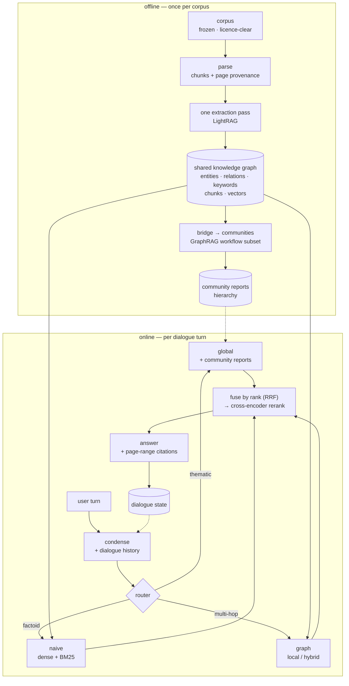

# HyRAG — a hybrid RAG pipeline

A RAG-based dialogue system over a corpus of Airbus/Boeing-related documents, in which **naive RAG, GraphRAG and LightRAG coexist and complement each other** rather than competing.

One sentence: **one extraction pass builds one shared knowledge graph; three retrieval strategies read it; a router picks per turn; a dialogue layer holds the conversation together.**

---

## Architecture at a glance

One extraction pass → two artifacts (graph, community reports) → three strategies → one router → one cited answer. Evaluation (not drawn): a frozen three-class question set judged on comprehensiveness, diversity and empowerment, with directness as control. Full structure: `PREPLAN.md` §2–§3.

---

## Read in this order

1. **`ROADMAP.md`** — the box list. 30-second read. Where we are and what closes each box.
2. **`nodes/⟨id⟩-*.md`** — **the current node's page only.** Written when a node opens, never in advance. *(`nodes/corpus.md` closed 2026-10-07; `nodes/parse.md` is current.)*
3. **`PREPLAN.md`** — the architecture and decision record. **Cite by section; do not read it linearly.** §4 is the decisions table (D1–D15), **§6.1 is the tech stack**, §8 is the verified-facts table. Those three get cited most.
4. **`papers/`** — the three source papers. `graphrag_google.pdf` **is** the Microsoft GraphRAG paper despite the filename.

**Vocabulary — "node" means four different things here:** a **roadmap node** (a box in `ROADMAP.md`), a **node page** (its design doc under `nodes/`), a **LangGraph node** (a step in the `StateGraph`), and a **KG node** (an entity in the graph). Say *box*, *page*, *step*, *entity* when it matters.

---

## State — as of 2026-10-07

**Corpus acquired and frozen.** 18 documents · 3,939 pp (`CORPUS.md`, `corpus.sha256`); dev slice v1 · 508 pp (`slice.sha256`). No code yet.

- **Corpus:** FAA PHAK/AFH/AIM + FSB 737 · 5 NTSB AARs · 2 AAIB reports · 5 Airbus Safety First articles · 2 OEM MMELs (Boeing 737, Airbus A320 — link-only). PDFs stay local; hashes are committed.
- **`corpus` → done. `parse` is the current node** (`nodes/parse.md`). Everything downstream is `unknown`.
- Git initialized 2026-10-07; **first commit pending** — the eval-set freeze is enforced by commit order.

---

## Landmines

Non-obvious constraints. Each has already cost time once.

**Corpus**
- All FCOM / FCTM / AMM / AFM / QRH / MEL / CCOM are proprietary **and** carry export-control exposure. Do not use leaked copies. Public substitutes are in `PREPLAN.md` §11.
- Pick documents by **extractability, not brand** (D14). Boeing's ACAP is the most official free document and the worst graph material — dimension tables, no prose, so it extracts into entities with no relationships.
- NTSB docket OEM exhibits are **not** republishable — NTSB's own policy says so. Dockets are a source of facts, not OEM text.

**Provenance**
- Citations are `file, §section, page range` — **never a single page number** (D13). Page anchors exist in the parser sidecar but LightRAG drops them at chunking, and **~two thirds of chunks span a page boundary**. The block→page join is custom code we own.
- LightRAG's `native` parser **refuses PDFs** (docx/md/textpack only); `legacy` emits no sidecar at all. Page-aware PDF parsing needs Docling or MinerU running as a service.

**Retrieval**
- LightRAG `mix` = local + global + **naive**; `hybrid` = local + global. `mix` already contains the factoid arm, so **`mix` + reranker is the baseline to beat**. LightRAG's own README calls community reports *"inefficient"* — part of this project is an empirical test of that claim.
- The reranker goes **after** fusion, never before. RRF merges by rank across incomparable score spaces; the reranker re-scores the fused shortlist with one model. RRF's `k` sets the reranker's recall ceiling.
- The class→mode mapping stays a **table in our code**, never a decision made inside the model — otherwise it cannot be ablated.
- Extraction is **incremental**; the community layer is **rebuild-only**. Community detection needs a fixed `seed` or results are not reproducible.

**Evaluation**
- The question set must be **frozen before the router exists**. A calendar constraint, not a preference.
- Never compare our numbers to the papers' published win rates — different corpus, model, questions. Only the protocol transfers.
- The `Directness` control is non-negotiable; without it a longer answer always wins.

---

## Environment

`brew` · `uv` · `node` · `python3` present. **No Docker, no Postgres, no pgvector yet.**

- **Use `uv`, not conda.** `python3` on PATH is Anaconda's; LightRAG's docs recommend `uv`. Anaconda's `pg_config` is also on PATH — harmless for bottled installs, a hazard for source builds.
- Storage: **Postgres via Homebrew + NetworkX for the graph** — no containers (D15). `tsvector` is Postgres core, so the lexical arm needs no extension.
- NetworkX requires the LightRAG server to run **single-worker** (`WORKERS=1`); multiple workers each hold their own graph and corrupt each other.
- **Disk is tight: ≈17 GB free as of 2026-10-07 (the corpus is 0.45 GB; models and indexes will dominate).** Models, images and indexes will want several GB.

---

## Next step

Open the **`parse`** node (`nodes/parse.md`): decide the parser service (Docling vs MinerU — `PREPLAN.md` §10 Q1), build the parser→chunk block→page join, and pass the gate on the dev slice: one real PDF → one retrieved chunk → resolves to `file, §section, p. N–M`. Never develop against the full corpus — re-extraction is the one cost that can stop this project.
