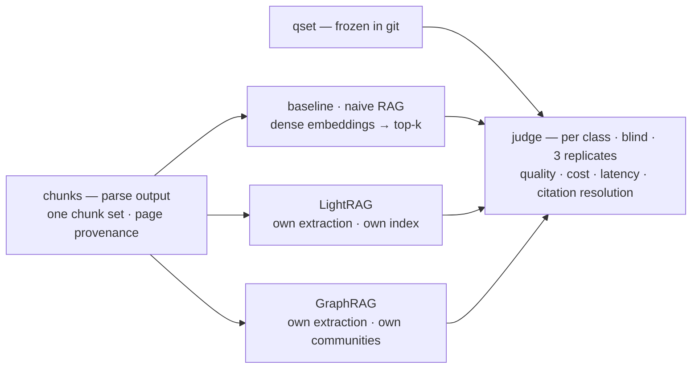
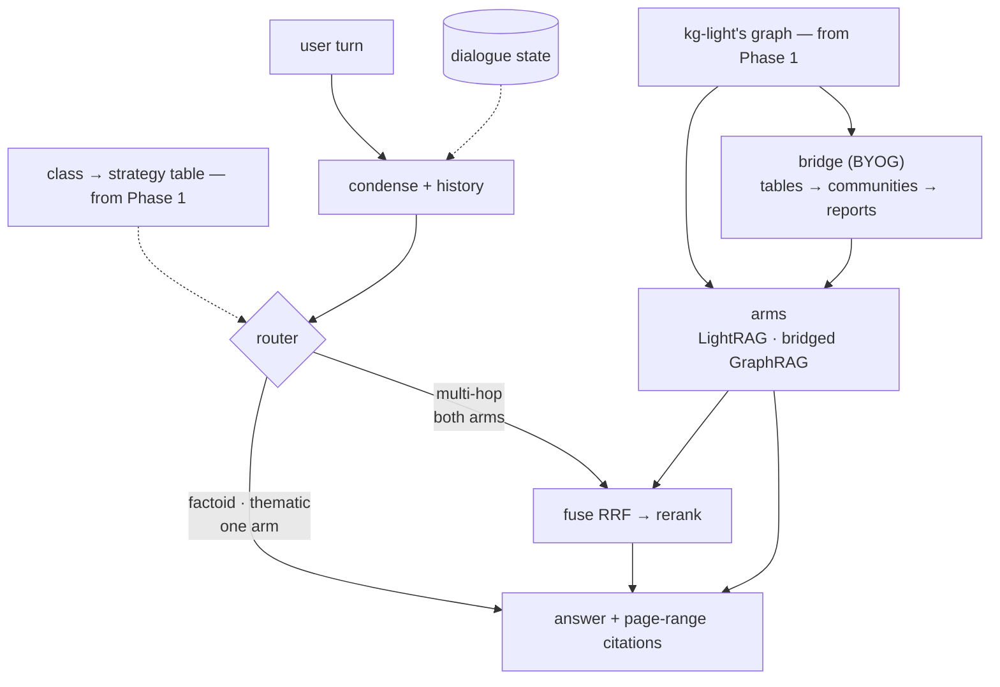

# HyRAG — benchmark two augmentation methods, then unify them

Two deliverables over one corpus of Airbus/Boeing-related documents — two phases, kept apart:

1. **Phase 1 — the benchmark.** Three complete systems answer the same frozen question set over the same chunks — a **naive-RAG baseline**, **LightRAG**, and **GraphRAG** — judged per question class, plus cost, latency and citation resolution. *It never ships.*
2. **Phase 2 — the delivered dialogue system.** One extraction pass: LightRAG extracts, its graph feeds GraphRAG's community layer, a router sends each turn to the arm the benchmark says wins that class, and every answer carries `file, §section, p. N–M` citations. *It never re-measures.*

One sentence: **measure three systems standalone; deliver a fourth that shares one graph, routes per class, and holds the conversation.**

Why unify at all: extraction dominates indexing cost, and the benchmark keeps GraphRAG's native index around — so the price of sharing one graph is a **measured number**, not an assumption.

**`REPORT.md` is the written deliverable** — results, costs, findings and limitations, every figure traced to an artifact. This file is the map of what was built and how it was judged.

---

## Results at a glance

Judged on the dev slice (12 documents, 508 pp): 150 questions, 50 per class, thematic sampled at n = 20. **Rubric mean** is the mean of the papers' three criteria (Comprehensiveness · Diversity · Empowerment); **accuracy** is the gold-anchored column reported *beside* that rubric, never inside it.

| row | class | rubric mean | accuracy | retrieval hit | $ / query | latency |
|---|---|---|---|---|---|---|
| **R1** naive RAG | factoid | 0.795 | **1.000** | 1.00 | 0.0025 | 2.2 s |
| | multi-hop | 0.803 | **0.897** | 0.98 | 0.0032 | 7.2 s |
| | thematic | **0.953** | — | 0.40 | 0.0048 | 18.7 s |
| **R2** LightRAG | factoid | 0.803 | **1.000** | 1.00 | 0.0047 | 4.2 s |
| | multi-hop | **0.870** | **0.903** | 0.98 | 0.0054 | 10.8 s |
| | thematic | 0.942 | — | 0.40 | 0.0094 | 51.3 s |
| **R3** GraphRAG | factoid | 0.790 | 0.917 | 0.84 | 0.0026 | 27.4 s |
| | multi-hop | 0.821 | 0.789 | 0.92 | 0.0039 | 40.7 s |
| | thematic | 0.947 | — | **1.00** | **0.3796** | **357.8 s** |
| **R4** delivered | factoid | **0.912** | 0.980 | 0.96 | 0.0053 | 4.9 s |
| | multi-hop | 0.831 | 0.895 | 0.98 | 0.0089 | 30.6 s |
| | thematic | 0.818 | — | 0.25 | 0.0106 | 41.8 s |

Thematic has no gold answer by construction, so it carries no accuracy column. Head-to-head, blind and shuffled over three replicates, **GraphRAG wins every class: 76% · 65% · 90%**.

What that table says, in four lines:

- **The papers' protocol reproduces** — on a corpus its authors never saw, the graph-augmented row wins every class pairwise.
- **The win is coverage, not correctness.** R3 wins the rubric and has the *lowest* accuracy on both classes with a gold answer (0.917 / 0.789 against 1.000 / 0.903 for LightRAG), at **79× the baseline's cost and 19× its latency** on thematic. 94% of Comprehensiveness scores are exactly 1.0, so a bounded scale cannot rank "covers more" — the paired comparison carries the claim.
- **The delivered row holds the citation contract:** 0 invented citations across 120 judged answers, resolution 1.00, pointwise best on factoid. Its thematic cell is the weakest — an evidence-budget artefact (top 12 chunks), not a property of the arms.
- **Sharing one extraction pass pays in tokens, not in time:** the bridged index costs **−60% calls and −23% tokens** but runs **1,811 s against R3's 1,527 s**, because embeddings dominate and the bridged graph is 56% larger.

Whole project spend: **$17.66** in proxy-logged calls, **≈ $18.93** all-in. The other seven findings, the cost table by row and the limitations are in `REPORT.md`.

---

## Architecture at a glance

**Two phases, two pictures — kept apart on purpose.** Phase 1 measures and never ships; Phase 2 ships and never re-measures. What they share is the corpus, the chunks and the question set.

### Phase 1 — the benchmark

Three systems, one question set, one judge — each measured as its authors built it. Output: the per-class results table **and** the `class → arm` table Phase 2's router runs on.

### Phase 2 — the delivered dialogue system

One extraction pass, one graph, two arms, one cited answer. The router picks a **strategy** per class — one arm for factoid and thematic, both fused for multi-hop — from a table read off Phase 1's results. No naive arm and no GraphRAG-native index here: both belong to Phase 1.

All four rows of the judge read the **same chunks**, so a difference between them comes from extraction and retrieval rather than from chunk boundaries.

---

## The three question classes

Every row is measured on the same three kinds of question, and the class is what the router routes on.

| class | what it asks | what it separates |
|---|---|---|
| **factoid** | one fact, present in one chunk — *"What's the maximum operating altitude of the A320?"* | chunk-level retrieval; dense RAG is strong here |
| **multi-hop** | two facts that must be connected — *"Which systems does the CFM56-7B26 engine affect on the 737NG?"* | graph traversal: the connection lives between chunks, never inside one |
| **thematic** | recurring themes across documents — *"What are the recurring themes in the accident reports across both manufacturers?"* | summarisation over communities; no chunk list answers it |

The instrument is `qset/questions.jsonl` — **150 questions, 50 per class**, each with a gold answer and the evidence target (the chunk ids, hence the page range) that contains it. It was frozen at commit `2c5de79`, before any router existed; that ordering is what the benchmark rests on.

---

## Component contracts

Each box as a black box: what it is responsible for, and what it is explicitly **not**.

| box | contract | not responsible for |
|---|---|---|
| **Parse** | text with section structure, table integrity and a resolvable page range per chunk | embeddings, entities, retrieval |
| **Chunker** | chunks that carry their block ids, deduplicated, with every collapsed duplicate's locations kept | the chunk-size policy beyond the measured setting |
| **Question set** | 150 questions, 50 per class, each with a gold answer and an evidence target | judging, retrieval, routing |
| **Baseline index** | standalone dense retrieval over the shared chunks — the naive RAG both papers use as their control | graphs, communities, lexical retrieval, reranking |
| **LightRAG index** | entities, relations (+keywords), chunks, vectors, and an unbroken provenance chain back to a source page | summarisation, community structure |
| **GraphRAG native index** | GraphRAG's own extraction, communities and reports over the same chunks | the delivered system |
| **Bridge + community layer** | GraphRAG's tables built from LightRAG's graph, then a hierarchy of communities with one report each | retrieval, routing |
| **Condense** | turn N + history → one standalone query | choosing a retrieval strategy |
| **Router** | standalone question → one strategy class, from the benchmark's class→strategy table | retrieval, generation |
| **Retrieval arms** | one interface: `question → ranked evidence + provenance + AnswerRecord` (answer, citations, evidence ids, tokens, latency) | generation, conversation state |
| **Fuse / generate** | one answer whose citations resolve to a real page | routing |
| **Dialogue state** | conversation memory across turns; `thread_id` = conversation | being a second, unversioned knowledge store |
| **Evaluation** | four rows × three classes, reproducible from one command | tuning the system it measures |

---

## Evaluation protocol

The protocol comes from the two source papers; their published numbers do not — different corpus, different model, different questions.

- **Four rows, three classes.** Naive RAG · LightRAG · GraphRAG, each standalone, plus the delivered system. Every row answers the same frozen question set over the same chunks.
- **Judged blind and shuffled** — pointwise for the matrix, one pairwise comparison for the headline, three replicates, because a judge is stochastic. One criterion opposes the others on purpose.
- **Three hard metrics, not judged:** cost per query, latency per query, and **citation resolution** — does the cited `file, §section, p. N–M` actually contain the cited content?
- **One ablation:** the same global search over GraphRAG's native graph and over the bridged one. The delta is the measured price of sharing a single extraction pass.
- **Reproducible from one command**: the frozen question set, the judge's prompts and rubric version saved beside the results, library versions pinned.

**Citations resolve through ids, never through text.** A chunk names the blocks it was built from, each block names its physical page, and the document's printed-page map closes the chain — a map that may legitimately have no entry, in which case the citation says `(physical)` rather than guessing. Two traps are handled in code: identical chunk text collapses under LightRAG's content hash (so duplicates are collapsed at chunking with every location kept), and **59% of chunks cross a page boundary** — which is why a citation is always a range and never a single page.

---

## What is in this repo

| path | what |
|---|---|
| **`REPORT.md`** | **the written deliverable** — benchmark and delivered-system results, costs, ten findings, limitations, pins |
| `PREPLAN.md` | the architecture plan and the numbered decision record the design rests on |
| `nodes/⟨id⟩-*.md` | one design page per pipeline stage, thirteen of them, all closed |
| `sessions/` | the working journal, one file per session — the debug trail behind each node |
| `hyrag/` | the pipeline: `parse/` (PDFs → anchored blocks) · `chunker/` (blocks → chunks carrying page ranges) · `qset/` (the question-drafting harness) · `embedding/` + `serving/` (one encoder, behind a local `/v1/embeddings` and `/v1/chat/completions` service) · `baseline/` (R1) · `kg_light/` (R2) · `kg_graph/` (R3, plus `bridge/`) · `judge/` (the blind four-row harness) · `router/` · `arms/` · `fuse/` (RRF + cross-encoder rerank) · `answer/` (the delivered answer) · `report/` (the deliverable's own checks) |
| `qset/questions.jsonl` | the evaluation instrument: 150 questions, each with a gold answer and an evidence target |
| `results/` | every judged table and gate record — `results.csv`, `head_to_head.csv`, `class_strategy.json` |
| `corpus/`, `CORPUS.md` | the documents, and their provenance and licence notes |
| `papers/` | the two source papers |

`parsed/` holds parse, chunk and index outputs and is regenerated, not committed.

**Three sizeable facts, for orientation:** the corpus is 18 documents · 3,939 pp, and the evaluation runs on the **508 pp dev slice**; the pipeline turns it into **375 chunks** (369 unique, 6 collapsed duplicates) and 150 questions; the two index builds are LightRAG's **4,525 entities · 6,835 relations** and GraphRAG's **2,817 entities · 5,895 relations · 644 communities**, against the bridged index's **4,389 entities · 6,775 relationships · 932 communities** — one extraction pass, 56% more entities to summarise.

---

## Reproducing this

Pinned. These five decide whether a number is reproducible:

| what | pin | source |
|---|---|---|
| GraphRAG | `graphrag==3.3.0`, own interpreter | `envs/graphrag/requirements.txt` |
| LightRAG | rev `453dce8` | `pyproject.toml` |
| completion model | `deepseek-flash`, thinking disabled for extraction and JSON | `parsed/llm_proxy.jsonl` |
| embeddings | `bge-m3`, 1024 dims, local service | `hyrag/serving/embeddings.py` |
| reranker | `BAAI/bge-reranker-base`, 512-token window, CPU | `hyrag/fuse/rerank.py` |

- **No containers.** Postgres 17 + `pgvector` from Homebrew holds the KV, vectors and status; the graph stays an in-process NetworkX object, so the server runs single-worker.
- **Two interpreters, on purpose.** `.venv` holds everything except GraphRAG; `.venv-graphrag` holds `graphrag==3.3.0`, because it and `docling` require disjoint `typer` ranges.
- **One service must be running.** `.venv/bin/python -m hyrag.serving.cli serve` (`:8001`) offers local bge-m3 embeddings **and** the DeepSeek chat route, which is also where per-call token accounting comes from. R2 and R3 depend on it; the baseline imports the encoder in-process.
- **Nothing leaves the machine** except calls to the local DeepSeek endpoint: the corpus holds © OEM material under terms that forbid posting it on any network.
- Commands are `uv run python -m …` from the repo root, grouped by node — `REPORT.md` §7 has the ordered list. Each stage ships its own gate (`… check`), and a stage is only "done" when that gate prints green.

Everything else — the library traps, the disk ceiling, the serving-process hazards — is in *Landmines* and *Environment* at the end of this file, for whoever runs the code next.

---

## Landmines

*Appendix — none of this is needed to read the results. It is here for whoever runs the code.*

Non-obvious constraints. Each has already cost time once, or is verified in the source and would cost time silently.

**Corpus**
- All FCOM / FCTM / AMM / AFM / QRH / MEL / CCOM are proprietary **and** carry export-control exposure. Do not use leaked copies. Public substitutes: `CORPUS.md`.
- Pick documents by **extractability, not brand** (D14). Boeing's ACAP is the most official free document and the worst graph material — dimension tables, no prose.
- NTSB docket OEM exhibits are **not republishable** — NTSB's own policy says so.

**Provenance**
- Citations are `file, §section, page range` — **never a single page number** (D13). Page anchors exist in the parser sidecar but LightRAG drops them at chunking, and **59% of chunks span a page boundary** at the shipped chunk size (measured on the slice). The block→page join is custom code we own.
- LightRAG's `native` parser **refuses PDFs** (docx/md/textpack only); `legacy` emits no sidecar. Page-aware parsing is Docling, native, in-process.
- **Duplicate chunk text collapses.** LightRAG keys chunks with a content hash, so two byte-identical chunks — routine in an MMEL — become **one** key with **one** `file_path`, and a citation then points at the wrong document. Handled at chunking: exact duplicates are collapsed and **every** location is recorded, and the checks assert no identical pair reaches the ingest set (6 collapsed on the slice today). Same failure class as the entity merge below, one layer down.
- The bridge's id join is a **map with a gate**, never a fuzzy match — built by reading LightRAG's chunk records back and asserted bijective at ingest, with any unmapped `source_id` a stop-the-line error (see *Evaluation protocol* → *Citations resolve through ids*).
- **The route R2 uses keeps our chunks and loses the sidecar backfill.** LightRAG's three documented ingest paths each trade one of *our chunks* / *our `file_path`* / *extraction*; the fourth — SDK raw enqueue with a custom `chunking_func` — keeps all three, but custom chunker output is **not eligible for source-span sidecar backfill**, so the chunks carry no LightRAG-side page span. Fine here: page provenance comes from our own map (`chunk_id → occurrences → file, §section, page range`). Do not "fix" this by switching to the document pipeline — that re-chunks (D16).
- **The en dash is a landmine for every string comparison.** Our citations use `p. 62–63` with an **en dash U+2013** (`format_page_range`); the model reliably writes `p. 62-63` with an ASCII hyphen. A plain substring check therefore reads a *correct* citation as missing — it cost one answer its citation on the first baseline run. Fold dash variants on both sides before comparing (`hyrag/baseline/answer.py::_fold`). This applies to the **judge's citation-resolution metric** (§7.3) and to anything resolving LightRAG's `* [n] file_path` references back to our provenance. Same family as the `U+2212` minus sign in AIM's page labels.

**Retrieval**
- LightRAG `mix` = local + global + **naive**; `hybrid` = local + global. `mix` already contains the factoid arm, so **`mix` + reranker is the strongest thing the delivered system has to beat**. LightRAG's own README calls community reports *"inefficient"* — part of this project is an empirical test of that claim.
- **LightRAG ships no lexical index at all** — `naive` is chunk-vector-only, and there is no BM25 or `tsvector` anywhere in the codebase. Our baseline is **dense-only** too (decided 2026-10-11, to reproduce the naive RAG both papers compare against), so no row in either phase reads a lexical index — the hybrid baseline was dropped as a scope cut, and the report says so.
- The reranker goes **after** fusion, never before. RRF merges by rank across incomparable score spaces; the reranker re-scores the fused shortlist with one model. RRF's `k` sets the reranker's recall ceiling.
- The class→mode mapping stays a **table in our code**, never a decision made inside the model — otherwise it cannot be ablated.
- GraphRAG's `global_search` returns a **map-reduced answer**, not a ranked evidence list, and its context arrives **truncated and without scores**. Fusion is therefore only attempted where both systems emit comparable units; the thematic class stays route-only.
- Extraction is **incremental**; the community layer is **rebuild-only**. Community detection needs a fixed `seed` or results are not reproducible.

**Libraries and configuration**
- Pin **`graphrag==3.3.0`** and LightRAG at commit **`453dce8`** (v1.5.8). GraphRAG renamed its workflows at 2.0 (`create_final_entities`/`create_final_relationships`/`create_final_communities` → `extract_graph`/`finalize_graph`/`create_communities`), so older write-ups cite names that no longer exist. **The LightRAG pin currently resolves from a pristine local checkout** (`file:///Users/celery/Repos/lightrag-453dce8`) because GitHub fetches died mid-transfer three times; restore the `git+https://…@453dce8` source and re-lock when the network allows — the rev is the citation either way.
- **`huggingface.co` is unreachable from this machine; `hf-mirror.com` is not.** `curl` to the Hub returns HTTP 000 on IPv4 and IPv6 while the mirror returns 200, and `huggingface_hub` pointed at the mirror still fails on its metadata check — so `BAAI/bge-reranker-base` was fetched with `curl` into `models/reranker/` (gitignored) and loaded with `local_files_only=True`. Any new model follows the same route, and the path goes in the run record.
- **GraphRAG gets its own interpreter: `graphrag==3.3.0` requires `typer>=0.27`, `docling<0.27`.** No single environment holds both, so R3 lives in `.venv-graphrag` (pinned by `envs/graphrag/requirements.txt`) and is driven through `graphrag index` / `graphrag query` as a subprocess. Its config is versioned (`hyrag/kg_graph/settings.yaml` + `prompts/`) and copied into the run root, with both hashes in `parsed/kg_graph/index_record.json`.
- **GraphRAG's clustering uppercases entity names.** `graphrag/graphs/stable_lcc.py::_normalize_name` runs `html.unescape(name).upper().strip()` on every edge endpoint, and `create_communities` maps the cluster's node names back through `entities.title`. A title in any other case is dropped **silently** — `graphrag index` exits 0, prints no warning, and the communities table simply covers less of the graph: measured 2026-10-17, **370/4,525 entities (8%)** on the first bridged conversion, **3,771/4,389** after normalising the same way. Native GraphRAG never sees it because its extractor emits uppercase titles. Any table fed to the community layer needs uppercase `title`, `source` and `target`.
- **DeepSeek has no `json_schema`, and GraphRAG asks for it.** Community reports pass a Pydantic model as `response_format`; litellm turns that into `json_schema` and DeepSeek answers *"This response_format type is unavailable now"* — 675 of 2,655 calls, all of them community reports, before the repair, and **1,057 of 1,059** on the bridged run (2026-10-17). litellm will not drop it (`response_format` is listed as supported for the provider), so `hyrag/serving/llm.py` rewrites the type to `json_object` and forwards the rest unchanged. That proxy is also where per-call token accounting comes from (`parsed/llm_proxy.jsonl`) — **it logs the window, so any token figure quoted for a run must be filtered by that run's `started_at`/`finished_at`**, or it inherits the smoke root's calls.
- **LightRAG calls an LLM function as `func(prompt, system_prompt=…)`** — prompt positional first, model never positional. A `functools.partial(openai_complete_if_cache, model=…)` fails on the first extraction with *"got multiple values for argument 'model'"*; wrap it, and let the queue wrapper's `max_tokens` win over yours. Same trap for the embedding function: `openai_embed` is already decorated, so pass `openai_embed.func` through `EmbeddingFunc` rather than double-wrapping.
- **A FAILED document is never auto-resumed.** LightRAG's auto-resume set is PENDING/PROCESSING/PARSING/ANALYZING; a genuinely failed document needs an explicit retry, and until then `ingest` reports *"No documents to process"* while the row sits there. Re-enqueueing known content does not refresh it either — it writes a `dup-<hash>` stub that fails and lingers. `hyrag.kg_light.cli ingest --retry-failed` handles both.
- **LightRAG's optional extras are not in its default install** — `openai` and `asyncpg` must be added by hand (its Postgres backend is asyncpg, not psycopg). And `POSTGRES_PASSWORD` must *exist* in the environment even for a trust-auth cluster: `check_storage_env_vars` tests membership, not value.
- File-based storages write under **`working_dir/<workspace>/`**, so the NetworkX graph is at `parsed/lightrag/hyrag/graph_chunk_entity_relation.graphml` — one level deeper than `working_dir`.
- **Two processes sharing one MPS device make embedding-bound checks crawl.** Encode the reference with the server stopped, then compare over HTTP in a process that imports numpy only (`hyrag.serving.checks --write-reference`).
- **Dynamic community selection is off by default** in GraphRAG (`--dynamic-community-selection` = `False`). Miss the flag and global search degrades to flat top-k over reports — the exact thing the design rejects — with no error.
- Community reports reach the caller with their **full text only when `use_community_summary=False`**.
- Do **not** select LightRAG's Postgres **graph** backend: it is Apache AGE-based, a build-from-source hazard on a Homebrew Postgres. Graph storage is NetworkX; Postgres carries KV, vectors and document status.
- Both systems point at the **same** local embedding service; GraphRAG's `vector_size` must match it, and fails fast if it does not.
- **DeepSeek's thinking is on by default** (`deepseek-flash`, effort `high`). Anything that must emit clean JSON — the question drafter, the judge — passes `"thinking": {"type": "disabled"}`. `reasoning_effort: "low"` still thinks, and `chat_template_kwargs` is ignored (verified against the API, 2026-10-11).
- The judge runs **DeepEval offline**: `DEEPEVAL_TELEMETRY_OPT_OUT=1`, and **never** `deepeval login`. The corpus holds © OEM material under terms that forbid posting it on any network, so nothing leaves the machine except to our own DeepSeek endpoint. The key lives in `.env` (gitignored).

**Evaluation**
- The question set **is** frozen before the router exists — `2c5de79`, 150 questions with gold answers. A calendar constraint, not a preference, and that SHA is the proof.
- Never compare our numbers to the papers' published win rates — different corpus, model, questions. Only the protocol transfers.
- **Judged quality is the papers' three criteria**; a padding control was run and moved to a sensitivity variant, because it inverted the ranking rather than qualifying it (2026-10-16). `Accuracy` is reported beside the rubric, never inside it — long *and* right is a claim the rubric alone cannot make.
- Citation resolution is a **deterministic** check over the parse provenance, never a judged score (D8b).

---

## Environment

*Appendix — the machine the numbers were produced on.*

`brew` · `uv` · `node` · `python3` present. **No Docker** — and none needed.

- **Installed since 2026-10-12:** Postgres 17 + pgvector 0.8.7 (Homebrew, `hyrag` database, trust auth on localhost), `hyrag`'s Python deps via `uv` (docling, tiktoken, psycopg, pgvector, fastapi, uvicorn, openai, asyncpg, pyarrow, `lightrag-hku` at the pin).
- **Two interpreters, on purpose.** The repo's `.venv` holds everything except GraphRAG; `.venv-graphrag` holds `graphrag==3.3.0`, because it and `docling` require disjoint `typer` ranges. Rebuild the second with `uv venv --python 3.13 .venv-graphrag && uv pip install --python .venv-graphrag/bin/python -r envs/graphrag/requirements.txt`.
- **The serving process is something you must start:** `.venv/bin/python -m hyrag.serving.cli serve` (`:8001`) — **straight from the venv, not `uv run`**: `uv run` holds uv's cache lock for the process's lifetime, which blocks `uv cache prune`/`clean` (it cost a 300 s timeout once). It offers `/v1/embeddings` (local bge-m3) **and** `/v1/chat/completions` (DeepSeek, with `json_schema` → `json_object` and per-call token logging). **R2 and R3 both depend on it** — their LLM calls go through the chat route, which is where cost per query comes from; R1 imports the encoder in-process and needs neither (an embedding-only run, e.g. `hyrag.embedding.checks`, is the one thing that works without the service running).

- **Use `uv`, not conda.** `python3` on PATH is Anaconda's. Anaconda's `pg_config` is also on PATH — harmless for bottled installs, a hazard for source builds.
- Storage: **Postgres via Homebrew + NetworkX for the graph** — no containers (D15). `pgvector` for the dense index; `tsvector` is Postgres core but currently has no consumer.
- NetworkX requires the LightRAG server to run **single-worker** (`WORKERS=1`); multiple workers each hold their own graph and corrupt each other.
- **Disk is the tightest constraint on this machine — recheck before every download.** *2026-10-17 (after `fuse`): **3.1 GB free**, the data volume at 99% (182/228 GB).* The repo is 4.5 GB (`.venv` 1.5 GB · `.venv-graphrag` 0.78 GB · corpus 0.45 GB · `parsed/` 0.65 GB · `models/reranker` 1.1 GB). **Reclaimable:** `uv cache prune` (uv's cache is mostly unpacked wheels no environment references), `parsed/kg_graph/cache` (194 MB) and `parsed/kg_graph_bridged/` (316 MB, of which 194 MB is the report cache that makes `rerun` cheap). Do not start a download without clearing space first. Do not start a model download without clearing space first; a full disk fails as a confusing torch or Postgres error, not as an honest one.
